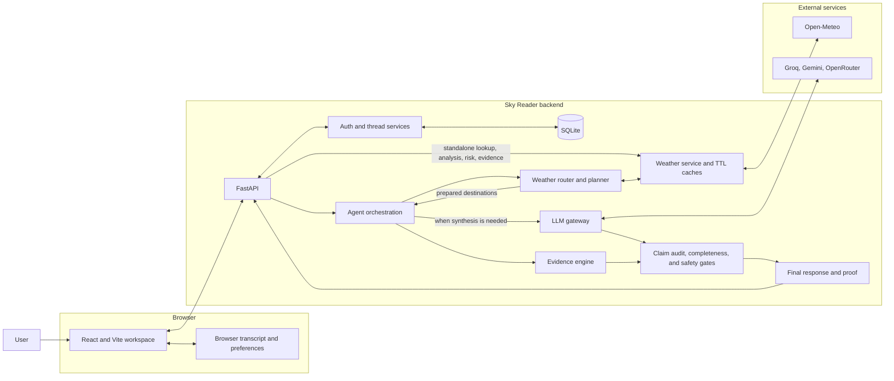
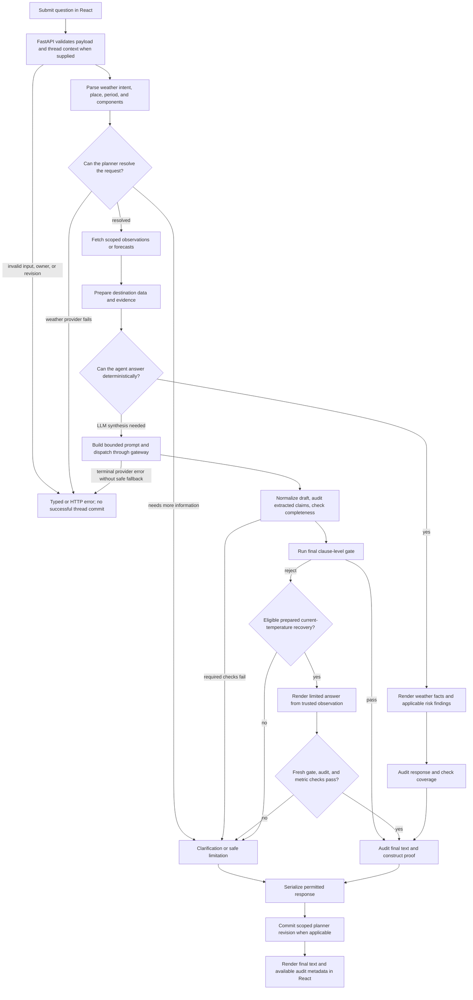
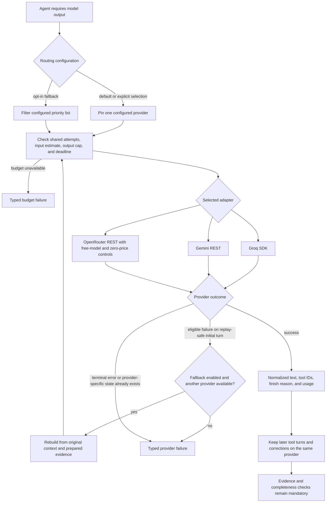
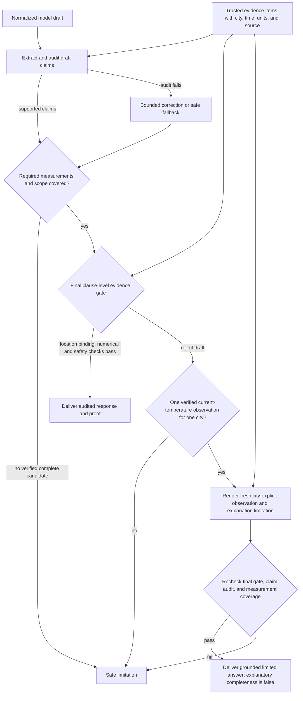
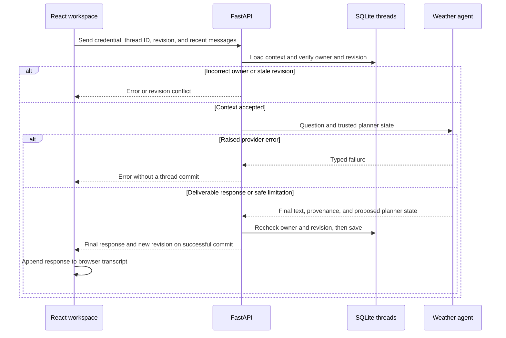

# Sky Reader

Sky Reader is an evidence-grounded weather assistant. Ask about current conditions, a forecast window, a trip, or two destinations. The application resolves the place, retrieves weather data, and checks factual claims against the evidence before delivering an answer.

The current architecture is implemented through **Stage 1.7E**. Simple requests can be answered deterministically. More detailed requests can use an LLM to explain prepared weather evidence, with separate checks for factual grounding, answer completeness, and final delivery.

## Features

- **Weather chat and city lookup** for current observations and supported local forecast windows.
- **Conversation-aware requests** with typed place resolution, clarification, explicit geographic qualifiers, and follow-ups that retain verified context.
- **Weather comparisons and risk guidance** covering supported destination pairs, relative time windows, clothing, and outdoor activity.
- **Evidence and audit views** showing claims, supporting data, validation status, provenance, and risk information when available.
- **Account and guest workspaces** with scoped browser transcripts and server-side revision checks for planner state.
- **Server-configured model routing** with Groq as the default and optional sequential fallback through Gemini and OpenRouter.

## Technology stack

| Layer | Technology |
|---|---|
| Frontend | React 19, Vite, JavaScript, CSS, Lucide icons |
| API and application models | Python, FastAPI, Pydantic, HTTPX |
| Weather | Open-Meteo geocoding and forecast APIs, process-local TTL caches |
| LLM | Groq SDK, Gemini REST, OpenRouter Chat Completions |
| Persistence | SQLite for account/session and thread context, browser storage for the UI transcript |
| Verification | pytest, Node test runner, ESLint, Vite build, mocked provider and frozen evaluation suites |

## Architecture

### 1. High-level system architecture

React renders the chat, lookup, session controls, and audit details. FastAPI owns the request boundary. The planner retrieves weather evidence, and the gateway is used only when the agent needs model output.



### 2. End-to-end weather request pipeline

Owned threads supply trusted planner context. The router and planner resolve the requested city and period before preparing data. Clarifications and typed failures can stop processing early. Deterministic answers bypass the model; prepared synthesis follows the separate model-draft validation path.



### 3. Provider selection, fallback, and budgets

Groq is the default. Deployments may pin an enabled provider or opt into sequential fallback. The default order is Groq, Gemini, then OpenRouter. A switch requires an eligible transient failure on the first replay-safe model turn and remaining shared budget.



### 4. Evidence validation and grounded recovery

**Passing the whole-draft audit does not automatically approve delivery.** The first audit checks extracted claims, while completeness checks that those supported claims answer the request. Separately, the final gate examines weather-shaped clauses, including assertions the extractor may have missed.



### 5. Conversation ownership and revision flow

The browser keeps the visible transcript. The server keeps owner-scoped structured weather context such as confirmed locations, destination slots, and applicable forecast windows. Revision checks protect against stale writes.



## How Sky Reader works

1. **Understand the request.** The router extracts weather intent, location, requested measurements, applicable activity, and period. The shared planner uses verified thread context to continue a task or asks for clarification when the place or comparison is unresolved.
2. **Retrieve the right data.** Typed geocoding distinguishes resolved, ambiguous, missing, and unavailable outcomes. Resolution considers explicit qualifiers and trustworthy candidate metadata. Weather retrieval uses confirmed coordinates. Forecast periods are scoped in the destination’s local time. Geocoding, current weather, hourly forecasts, and daily forecasts have separate in-memory caches.
3. **Prepare facts and decide how to answer.** Deterministic branches can render supported observations, forecasts, comparisons, or guidance from the requested measurements and risk evidence. When synthesis is needed, the model sees a compact city- and period-scoped evidence packet. The original weather payload is retained for verification.
4. **Validate before delivery.** The evidence engine represents observations, forecast points, and derived findings separately. Claims are checked against matching evidence and expose supporting IDs. Completeness considers the requested measurements, city, period, and relevant hazard or advice requirements.
5. **Protect the final response.** Clause validation requires an explicit evidence city or a narrowly permitted observation anchor. Stage 1.7E recognizes common single-city observation forms and some numeric continuations, including humidity, apparent temperature, and wind. Each inherited claim still undergoes unit, location, time, and numerical checks. Arbitrary skipped prose, mixed observation/forecast evidence, and multiple candidate cities restrict inheritance.
6. **Recover selectively.** Stage 1.7D can discard a rejected draft and render a limited current-temperature answer using exactly one verified observation for one city. The replacement is revalidated without an extra LLM call. It explicitly states that the detailed explanation was not verified. Compound, multi-city, forecast, and safety requests are outside this recovery path.

## Multi-provider gateway

| Provider | Adapter and controls | Verification status |
|---|---|---|
| Groq | Default adapter and default model `openai/gpt-oss-120b`. Existing SDK calls are normalized into bounded assistant messages. | Stage 1.7D passed one approved Lisbon live request through both audit layers and completeness. |
| Gemini | Google GenerateContent REST adapter. Tool state and supported thought signatures remain request-local and provider-specific. | Mocked adapter and fallback coverage. The approved live model returned HTTP 404; account/model access remains unresolved. |
| OpenRouter | Chat Completions REST adapter. Explicit free-model allowlist, zero prompt and completion price ceilings, and provider-side fallback disabled. | Mocked adapter and fallback coverage. The approved free model returned HTTP 404; serving-route availability remains unresolved. |

The browser does not select providers. Provider choice is server configuration, or an explicit choice by a backend caller. Fallback is off by default. Eligible failures include throttling, selected service errors, clear connection failures, and timeouts on the first replay-safe model turn. Authentication, malformed output, evidence rejection, and exhausted budgets do not trigger migration. Later tool turns and corrections remain pinned to the responding provider. Normal chat weather retrieval is planner-owned; tool schemas remain available to the injected executor compatibility path.

All model attempts share request-local token reservations, attempt counts, round and correction caps, and a monotonic model deadline. Reported usage reconciles estimates. Omitted usage remains unknown. See the [gateway configuration and limits](backend/llm_gateway/README.md).

## Project structure

```text
Sky-Reader/
├── backend/
│   ├── main.py                  FastAPI endpoints and API contracts
│   ├── database.py              SQLite schema, account and session operations
│   ├── conversation_store.py    Thread ownership, revisions and persisted context
│   ├── agent/                   Routing, planner, state, prompts, budgets and final gate
│   ├── weather/                 Open-Meteo clients, caches, models, analysis and risk
│   ├── evidence/                Evidence items, claim extraction, audit and proof
│   ├── llm_gateway/             Provider configuration, adapters and normalized messages
│   ├── evaluation/              Historical benchmarks, frozen suite and live harnesses
│   ├── tests/                   Backend regression tests
│   └── requirements.txt
└── frontend/
    ├── src/
    │   ├── App.jsx              Workspace composition and API origin
    │   ├── components/          Chat, city lookup, audit, risk and preferences
    │   └── utils/               Auth session, chat threads and browser persistence
    ├── tests/                   Node-based frontend regressions
    └── package.json
```

## Local setup

Use Python 3.12 for the verified backend workflow and Node.js 22.12+ in a supported LTS release for the frontend. Run the commands from the repository root. The examples use a POSIX shell. On Windows, activate the virtual environment with `backend\venv\Scripts\activate` using an appropriate shell, and use an ignored backend dotenv file or exported process variables for provider settings.

### Start FastAPI

```bash
python3.12 -m venv backend/venv
source backend/venv/bin/activate
python -m pip install -r backend/requirements.txt
python -m uvicorn backend.main:app --reload --host 127.0.0.1 --port 8000
```

Use the ignored `backend/.env` file or server process environment for secrets. There is no required frontend dotenv file. Open-Meteo and eligible deterministic weather paths do not require an LLM key. To use default model-assisted synthesis, set `GROQ_API_KEY`. Optional settings include `GROQ_MODEL`, `LLM_PROVIDER`, `LLM_ENABLED_PROVIDERS`, `LLM_FALLBACK_ENABLED`, and `LLM_PROVIDER_ORDER`. To enable a secondary provider, supply its key and explicit model through `GEMINI_API_KEY` and `GEMINI_MODEL`, or `OPENROUTER_API_KEY` and `OPENROUTER_MODEL`. Keep credentials out of the browser and repository root dotenv file.

The API is at [127.0.0.1:8000](http://127.0.0.1:8000), with [interactive API docs](http://127.0.0.1:8000/docs) and a [health route](http://127.0.0.1:8000/health).

### Start React

```bash
cd frontend
npm ci
npm run dev -- --host 127.0.0.1 --port 5173 --strictPort
```

Open [127.0.0.1:5173](http://127.0.0.1:5173). The checked-in frontend uses `http://127.0.0.1:8000` as its backend origin. FastAPI CORS permits the default local Vite origins on port 5173.

### API surface

| API routes | Purpose |
|---|---|
| `POST /api/agent/chat` | Chat with optional thread identity and expected revision |
| `GET /weather` | Standalone city lookup and weather |
| `GET /api/weather/analysis`, `GET /api/weather/risks` | Weather analysis and risk assessment |
| `POST /api/evidence/validate`, `GET /api/evidence/summary` | Standalone claim validation and evidence inspection |
| `/api/auth/*`, `/api/guest/session`, `/api/chat/threads` | Account, guest, and thread lifecycle |

## Testing and evaluation

Install `pytest` into the activated backend environment for offline regression work. Run the backend and frozen suite from the repository root with mocked providers. On a memory-constrained Linux host, use a verified cgroup with `MemoryHigh=512M`, `MemoryMax=768M`, and `MemorySwapMax=0`, and run checks sequentially with a bounded timeout. Avoid legacy live integration scripts when verifying offline.

```bash
python -m pip install pytest
GROQ_API_KEY= GEMINI_API_KEY= OPENROUTER_API_KEY= python -m pytest \
  backend/tests backend/test_analysis.py backend/test_phase4.py
GROQ_API_KEY= GEMINI_API_KEY= OPENROUTER_API_KEY= python -m backend.evaluation.stage163.run \
  --output /tmp/skyreader-stage163-results.json
```

From the frontend directory:

```bash
npm test
npm run lint
npm run build
```

The latest **Stage 1.7E offline verification** recorded **395 backend tests passed** and **79 focused tests passed**. The focused batch overlaps the backend suite.

| Frozen 120-case metric | Stage 1.7E |
|---|---:|
| Answer completeness | 101/120 |
| Required hazard coverage | 12/12 |
| Both-city measurement coverage | 7/8 |
| Grounded audited outputs | 88/88 |
| Unaudited numerical weather answers | 0 |

These results describe specific mocked fixtures and scoring denominators. The [frozen evaluation report](backend/evaluation/stage163/REPORT.md) documents the corpus and rubric. The [evaluation subsystem guide](backend/evaluation/README.md) describes the historical benchmark tooling.

## Live validation and limitations

The single approved [Stage 1.7D Groq run](backend/evaluation/stage17c/17D-GROQ-LIVE-REPORT.md) used a fixed Lisbon observation. It passed whole-draft grounding, the final evidence gate, and delivered-answer completeness without limited recovery. This verifies one live synthesis sample. The recovery path is covered by offline tests. Gemini and OpenRouter adapters have mocked coverage, and their approved live requests returned 404. See the [multi-provider diagnostic report](backend/evaluation/stage17c/DIAGNOSTIC-RETEST-REPORT.md) and [root-cause investigation](backend/evaluation/stage17c/FIX2-REPORT.md).

- Natural-language validation is conservative. A draft can contain a correctly supported claim and still be withheld if another clause cannot be grounded.
- Grounded recovery is deliberately limited to a verified single-city current-temperature observation after final-gate rejection.
- Forecast windows, geocoding data, provider model availability, and quotas constrain responses. A resolved city or supported adapter does not guarantee a particular forecast or provider route.
- Broader production reliability, high-severity live weather coverage, and successful live secondary-provider synthesis remain unverified.

## Development milestones

| Milestone | Implemented work |
|---|---|
| Weather and evidence foundations | Forecast retrieval, weather analysis, risk assessment, claim validation, and proof metadata |
| Stages 1.5–1.6.1 | Shared planning, typed geocoding, owner-scoped SQLite state, and safe provider failure handling |
| Stages 1.6.2–1.6.5 | Deterministic responses, completeness checks, evidence safety gates, bounded synthesis, and approval-gated live harnesses |
| Stages 1.7A–1.7C | Provider adapters, optional sequential fallback, and live compatibility diagnostics |
| Stages 1.7D–1.7E | Evidence-aligned prompts, limited grounded recovery, and safer recognition of natural observation continuations |

Pending verification includes live secondary-provider readiness and broader end-to-end reliability. The [architecture audit](backend/evaluation/stage17c/ARCHITECTURE-AUDIT.md) records the investigation that led to the Stage 1.7D and 1.7E changes.
