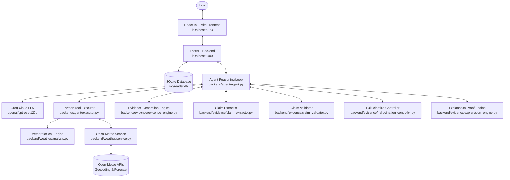

# 🌦️ Sky Reader (WeatherGPT)
### Agentic AI Weather Intelligence, Reasoning & Verification Platform

[](https://www.python.org/)
[](https://fastapi.tiangolo.com/)
[](https://react.dev/)
[](https://www.sqlite.org/)
[](https://groq.com/)
[](https://open-meteo.com/)
[](LICENSE)

**Sky Reader** is an agentic AI meteorological intelligence and deterministic claim verification platform. Beyond traditional weather forecasting apps, Sky Reader unifies **real-time Open-Meteo observations**, a **deterministic Python meteorological analysis engine**, **Groq LLM tool-calling**, a **formal Evidence Generation & Claim Validation System**, and a **visionOS/macOS-inspired glassmorphism frontend** featuring live particle simulation canvases, SQLite user authentication, and multi-model AI dispatching.

The platform is engineered with zero-tolerance for hallucinations: every AI-generated claim is parsed, audited against verified ground-truth meteorological records, and paired with an audited **Explanation Proof** before being served to the user.

---

## 🌟 Key Features & Capabilities

### 🎨 1. Visionary Glassmorphism UI & Ambient Atmospheric Canvas
- **Floating Glass Application Frame**: VisionOS/macOS-inspired frosted window (`backdrop-filter: blur(28px)`), rounded pill architecture, and realistic drifting sky clouds.
- **HTML5 Canvas Atmospheric Particle Engine**: Dynamic real-time weather simulations that automatically react to real weather or user preference:
  - ☀️ **Sunshine & Warm Radiance**: Golden sun rays and luminous particles.
  - 🌧️ **Rain & Precipitation**: Slanted raindrops with impact ripples.
  - ✨ **Midnight Stars**: Twinkling stardust and calm night sky.
  - 🍃 **Wind & Drifting Foliage**: Swaying leaves following fluid aerodynamic turbulence.
  - ❄️ **Snow & Blizzard**: Softly drifting snowflakes.
  - ⚡ **Thunderstorm**: Atmospheric lightning flashes and deep rain bursts.
  - ☁️ **Overcast**: Soft drifting ambient cloud layers.
  - 🔄 **Auto Mode**: Detects atmospheric conditions dynamically from Open-Meteo telemetry and agent claim extractions.
- **Eye-Friendly Warm Light & Dark Themes**: High-contrast dark mode for evening focus, paired with a soft warm parchment/linen light theme (`#ede8df` → `#c8bfb2`) specifically designed to eliminate screen glare and eye strain.

---

### 🧠 2. AI Model Engine Selector (`ModelSelector`)
Integrated centered dropdown pill allowing instant switching between specialized meteorological reasoning engines:
- ✦ **Sky Reader 4 (Default / Precision)**: Flagship reasoning engine with strict factual claim audits and zero-hallucination verification.
- ⚡ **Sky Reader 4 Turbo (High Velocity)**: Optimized for rapid multi-point hourly telemetry, swift radar analytics, and dynamic route planning.
- ⏱️ **Sky Reader 3.5 Flash (Ultra-Low Latency)**: Instant responses for quick temperature queries and daily summaries.
- 🌐 **Sky Reader Ensemble (Consensus Audit)**: Cross-validates atmospheric observations against deterministic physical models and consensus checks.

---

### 🔖 3. Saved Places Watchlist (`SavedPlacesView`)
- **Watchlist Dashboard**: Manage saved global locations with live temperature, condition label, humidity, wind velocity, and day/night badges.
- **Search & Auto-Validate**: Add new global locations with instant geocoding verification.
- **1-Click Quick Add Chips**: Pre-curated chips for world capitals (Tokyo, Zurich, Paris, New York, Reykjavik, Sydney, Dehradun).
- **Deep Integration**:
  - Jump directly into **Dashboard & Trips** for full 48-hour hourly forecasting.
  - 1-click **Ask AI** to consult the meteorological agent about that city.
  - **Save Place Bookmark Button** in the main city lookup header to bookmark any searched location.
  - Real-time counter badge on the left sidebar navigation pill.
  - Synced across `localStorage` and the SQLite database backend.

---

### 🔐 4. SQLite Authentication & Session Management
- **Encrypted Local Database (`backend/skyreader.db`)**:
  - `users` table: id, email, name, salt + PBKDF2-HMAC-SHA256 password hash, creation date, and saved cities JSON.
  - `sessions` table: cryptographically secure tokens, user ID, expiration timestamp, and cascade deletion.
- **Restful Auth Endpoints**:
  - `POST /api/auth/register`: New user onboarding with display name.
  - `POST /api/auth/login`: Authenticate email/password and issue session token.
  - `GET /api/auth/me`: Validate session token and return user profile.
  - `POST /api/auth/logout`: Invalidate session token.
  - `POST /api/user/saved-cities`: Synchronize saved places watchlist for authenticated users.
- **Animated Twilight Login Page**:
  - HTML5 Canvas aurora bands and stardust particles.
  - Glassmorphic login card with leading field icons (User, Mail, Lock).
  - Quick demo credentials autofill (`explorer@skyreader.ai` / `weather123`).
  - Google Social Login integration mock.
  - Dedicated Theme Toggle button on the authentication screen.
  - Automatic routing: unauthenticated guests land on the login screen; active sessions enter the app immediately.

---

### 🤖 5. Agentic AI Tool-Calling & Verification Loop
- **Autonomous Tool Dispatch**: Groq LLM dynamically determines whether a query requires geocoding, current weather, hourly forecasting, deep analysis, or direct conversational answers.
- **Complete Reasoning Cycle**: *User Query → Tool Invocation → Python Execution → Data Return → Model Synthesis → Grounded Answer*.
- **Structured Evidence Engine**: Extracts and tags all weather data into provenance-tracked records: `OBSERVED`, `FORECAST`, and `DERIVED`.
- **Deterministic Claim Extractor & Validator**:
  - Regex-based factual claim parsing (temperature, rain chance, wind speed, pressure, trends, umbrella advisories).
  - Domain-calibrated tolerances ($\pm 1.0^\circ\text{C}$ temperature, $\pm 5.0\%$ rain probability, $\pm 2.5\text{ km/h}$ wind).
  - Real-time status classifications: `SUPPORTED`, `PARTIALLY_SUPPORTED`, `CONTRADICTED`, `INSUFFICIENT_EVIDENCE`.
- **Hallucination Controller & Self-Correction**: Automatically detects contradictions and triggers targeted corrective regeneration with ground-truth evidence before returning to user.

---

### 🧭 6. City Lookup, Telemetry & Preferences
- **48-Hour Hourly Forecast Slider**: Hourly temperature cards, precipitation probability markers, and current hour highlight.
- **Telemetry Grid**: Beaufort wind scale, cardinal compass directions, barometric pressure trend, and humidity comfort indexing.
- **Decision Support Engine**:
  - ☔ **Umbrella Advisory**: Threshold-based recommendations with associated confidence levels.
  - 🏃 **Outdoor Activity Windows**: Ranks 6-hour blocks (Night, Morning, Afternoon, Evening) for ideal outdoor conditions.
  - 🚗 **Travel Suitability**: Evaluates hazards (heavy rain, severe winds, fog, thunderstorms).
- **Preferences & Settings Panel (`PreferencesView`)**:
  - Units toggle (Celsius °C / Fahrenheit °F).
  - Atmospheric scene override.
  - AI reasoning depth & hallucination verification toggles.
  - Chat history management and cache reset.

---

## 🏗️ System Architecture



---

## 🧰 Tech Stack

| Layer | Technology | Purpose |
|---|---|---|
| **Frontend Framework** | React 19, Vite | Fast modular component hierarchy & reactive state |
| **Styling & Effects** | Pure CSS3 & HTML5 Canvas | Glassmorphism, particle physics, custom scrollbars, dual themes |
| **Icons** | Lucide React | Clean, scalable iconography for weather, navigation, and telemetry |
| **Backend Framework** | Python 3.10+, FastAPI, Pydantic v2 | High-throughput async REST API, strict schemas, CORS |
| **Database** | SQLite3, PBKDF2-HMAC-SHA256 | Local, zero-configuration user storage and session management |
| **AI Inference** | Groq Cloud SDK (`AsyncGroq`) | Ultra-fast LLM inference using `openai/gpt-oss-120b` with tool calling |
| **Verification Engine** | Deterministic Python | Provenance tagging, regex claim parsing, domain tolerance validation |
| **Weather Telemetry** | Open-Meteo API | Free, high-accuracy global geocoding, current data, and hourly forecasts |

---

## 📁 Project Directory Structure

```text
Sky-Reader/
├── README.md                          # Comprehensive project documentation
├── .gitignore
├── backend/
│   ├── .env                           # Environment variables (GROQ_API_KEY, GROQ_MODEL)
│   ├── skyreader.db                   # SQLite database (auto-generated on startup)
│   ├── database.py                    # SQLite schema, password hashing, session tokens
│   ├── requirements.txt               # fastapi, httpx, pydantic, groq, python-dotenv
│   ├── main.py                        # FastAPI routes (Auth, Weather, Analysis, Chat, Evidence)
│   ├── agent/
│   │   ├── __init__.py
│   │   ├── agent.py                   # Groq tool-calling agent with validation loop
│   │   ├── executor.py                # Tool dispatcher executing weather & analysis functions
│   │   └── tools.py                   # OpenAPI schemas for weather tools
│   ├── weather/
│   │   ├── __init__.py
│   │   ├── analysis.py                # Meteorological trends, comfort, Beaufort, decision support
│   │   ├── service.py                 # Open-Meteo HTTP client with retry logic & formatters
│   │   ├── models.py                  # Pydantic response models
│   │   └── weather_codes.py           # WMO weather code to description & emoji mappings
│   ├── evidence/                      # Evidence & Claim Verification Subsystem
│   │   ├── __init__.py
│   │   ├── evidence_models.py         # EvidenceItem, FactualClaim, ExplanationProof schemas
│   │   ├── evidence_engine.py         # Extracts structured records with provenance tagging
│   │   ├── claim_extractor.py         # Deterministic regex-based factual claim extractor
│   │   ├── claim_validator.py         # Deterministic validator with domain tolerances
│   │   ├── hallucination_controller.py# Metrics calculation, feedback loop & safe fallback
│   │   └── explanation_engine.py      # Generates ExplanationProof & Markdown audit chains
│   └── tests/                         # Unit & integration test suites
└── frontend/
    ├── index.html
    ├── package.json
    ├── vite.config.js
    └── src/
        ├── main.jsx
        ├── App.jsx                    # Root state orchestration & view management
        ├── App.css                    # Complete CSS tokens, glassmorphism, animations, dual themes
        ├── components/
        │   ├── ChatHeader.jsx         # Header bar with model selector, atmosphere, theme, New Chat
        │   ├── ModelSelector.jsx      # Interactive dropdown selector for AI reasoning engines
        │   ├── WeatherAtmosphere.jsx  # HTML5 Canvas particle simulation engine
        │   ├── AtmosphereSelector.jsx # Ambient weather animation selector pill
        │   ├── Sidebar.jsx            # Responsive left navigation with unconstrained scrolling & badges
        │   ├── SavedPlacesView.jsx    # Dedicated watchlist view with live city cards & quick add
        │   ├── LoginPage.jsx          # Twilight aurora canvas login card with authentication
        │   ├── WelcomeHero.jsx        # Conversational starter cards and capsule input
        │   ├── ChatMessage.jsx        # Left/right chat bubbles with timestamp & telemetry embeds
        │   ├── WeatherSnapshot.jsx    # Visual telemetry cards (temp, humidity, rain %, umbrella)
        │   ├── AuditDrawer.jsx        # Collapsible verification & explainability drawer
        │   ├── ThinkingIndicator.jsx  # Animated typing status indicator
        │   ├── ChatInput.jsx          # Bottom fixed textarea, quick suggestions & send button
        │   ├── CityLookup.jsx         # 48h forecast, hourly slider, telemetry & bookmark toggle
        │   └── PreferencesView.jsx    # Settings panel for units, theme, and AI reasoning depth
        └── utils/
            ├── weatherAtmosphere.js   # Atmosphere detection logic & scene presets
            └── weatherIcons.jsx       # WMO code to Lucide weather icon mapper
```

---

## 🚀 Quickstart Guide

### Prerequisites
- **Python 3.10+**
- **Node.js 18+** and **npm**
- **Groq API Key** (available free at [console.groq.com](https://console.groq.com/))

### 1. Clone the Repository
```bash
git clone https://github.com/TaruneshM/Sky-Reader.git
cd Sky-Reader
```

### 2. Configure Backend Environment
Create or edit `backend/.env`:
```bash
GROQ_API_KEY=gsk_your_groq_api_key_here
GROQ_MODEL=openai/gpt-oss-120b
```

### 3. Install & Start Backend Server
```bash
# Windows
python -m venv backend\venv
backend\venv\Scripts\activate
pip install -r backend\requirements.txt

# Run FastAPI server
cd backend
uvicorn main:app --reload --port 8000
```
- API live at: **http://127.0.0.1:8000**
- Interactive Swagger docs: **http://127.0.0.1:8000/docs**

### 4. Install & Start Frontend Server
In a separate terminal:
```bash
cd frontend
npm install
npm run dev
```
- Frontend live at: **http://localhost:5173**

---

## 🔌 API Reference Summary

| Method | Endpoint | Description |
|---|---|---|
| `GET` | `/` | Service health status |
| `POST` | `/api/auth/register` | Register a new user profile in SQLite |
| `POST` | `/api/auth/login` | Authenticate user and issue session token |
| `GET` | `/api/auth/me` | Retrieve profile of authenticated user |
| `POST` | `/api/auth/logout` | Terminate and invalidate session token |
| `POST` | `/api/user/saved-cities` | Synchronize saved watchlist locations |
| `GET` | `/weather?location={city}` | Real-time weather and 48-hour forecast |
| `GET` | `/api/weather/analysis?location={city}&focus={focus}&day_offset={0\|1}` | Advanced meteorological metrics & decision support |
| `POST` | `/api/agent/chat` | Verified agentic reasoning with claim extraction & audit loop |
| `POST` | `/api/evidence/validate` | On-demand deterministic claim extraction & validation |

---

## 💡 Example User Queries

- *"What is the current temperature in Dehradun?"*
- *"Will it rain tomorrow in Paris? Should I carry an umbrella?"*
- *"Is the temperature increasing or decreasing over the next 24 hours in Tokyo?"*
- *"What is the best 6-hour outdoor activity window tomorrow in Zurich?"*
- *"Is tomorrow suitable for driving in Chennai?"*
- *"Can you audit the claims in your forecast against verified evidence?"*

---

## 📜 License & Acknowledgements

- **License**: MIT License
- **Weather Data**: Real-time telemetry provided by [Open-Meteo](https://open-meteo.com/).
- **AI Inference**: High-speed LLM inference powered by [Groq](https://groq.com/).
