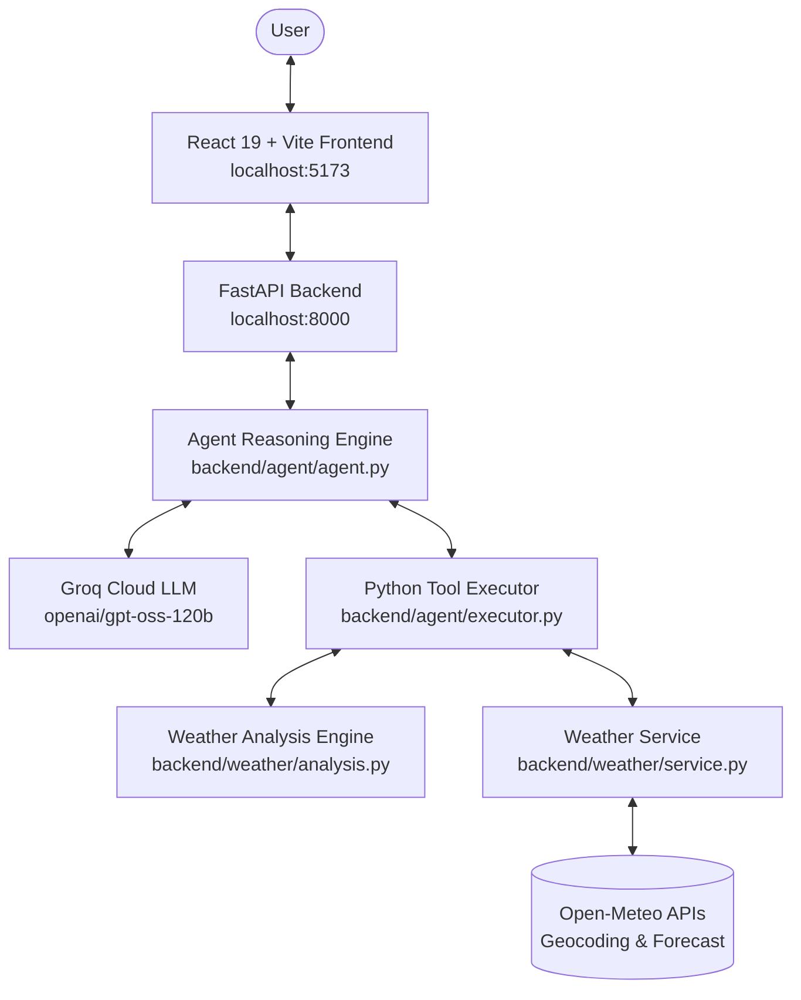
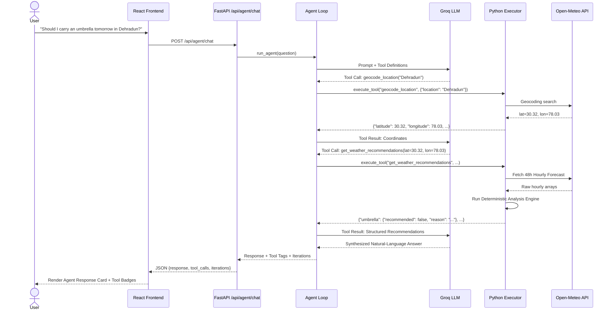

# 🌦️ Sky Reader (WeatherGPT)
### Agentic AI Weather Intelligence & Reasoning System

[](https://www.python.org/)
[](https://fastapi.tiangolo.com/)
[](https://react.dev/)
[](https://groq.com/)
[](https://open-meteo.com/)

**Sky Reader** is a full-stack, agentic AI weather intelligence system. Beyond basic weather lookups, Sky Reader combines **real-time Open-Meteo meteorological data**, a **deterministic Python weather analysis engine**, and **Groq LLM tool-calling** to interpret weather trends, evaluate atmospheric patterns, and generate evidence-based decisions (such as umbrella recommendations, travel safety advisories, and optimal outdoor activity windows).

---

## ✨ Features

### 📍 Phase 1: Real-Time Weather Foundation
- **Automated Geocoding**: Converts natural-language place names into latitude and longitude coordinates.
- **Current Conditions**: Temperature, apparent ("feels-like") temperature, relative humidity, wind speed, wind direction, surface pressure, cloud cover, and WMO weather condition with emoji icons.
- **Hourly Forecast**: Up to 48 hours of detailed hourly weather projections.
- **Validated Schemas**: End-to-end data validation using Pydantic models.

### 🤖 Phase 2: Agentic AI Tool Calling
- **Autonomous Tool Selection**: Groq LLM dynamically determines whether a query requires weather tools, geocoding, forecast data, or deep analysis.
- **Multi-Turn Reasoning Cycle**: Follows the complete tool-calling loop: *User Query → Model Decision → Python Executor → Real Data Return → Model Synthesis → Natural-Language Response*.
- **No Hallucinated Data**: The LLM is strictly constrained to synthesize factual weather measurements executed through Python.
- **Graceful Fault Tolerance**: Handles missing API keys, rate-limit backoffs (TPM limit protection), ungeocodeable locations, and unknown tool requests.

### 🧠 Phase 3: Meteorological Intelligence & Decision Support
- **Temperature Trend Analysis**: Detects trend trajectories (`increasing`, `decreasing`, `steady`), computes diurnal ranges, hourly deltas, and flags the steepest morning rises and evening drops.
- **Humidity & Comfort Dynamics**: Evaluates moisture levels (`dry`, `comfortable`, `moderately humid`, `oppressive`) and explains how humidity modifies thermal perception.
- **Precipitation Probability vs. Accumulation**: Distinguishes between **chance of precipitation** (e.g. 80% probability of sprinkles) and **expected rainfall volume** (0.1 mm vs. 15 mm downpour), isolating peak risk hours.
- **Wind & Gust Analysis**: Translates degrees into 16 cardinal compass directions (N, NE, E, SE, etc.), evaluates Beaufort-scale wind force categories, and flags strong wind periods (≥20 km/h).
- **Atmospheric Pattern Detection**: Correlates falling surface pressure with rising humidity and cloud cover to detect approaching weather fronts or storms.
- **Time Aggregations (6-Hour Blocks)**: Groups forecasts into **Night (00–06)**, **Morning (06–12)**, **Afternoon (12–18)**, and **Evening (18–24)** blocks.
- **Day-over-Day Comparison**: Directly contrasts Today vs. Tomorrow across temperature, precipitation variance, and wind speeds.
- **Decision Support**:
  - ☔ **Umbrella Advisory**: Evaluates rain probabilities and accumulation thresholds with confidence scores.
  - 🏃 **Outdoor Activity Windows**: Ranks 6-hour blocks to find optimal periods (ideal temperature, low rain chance, calm breeze).
  - 🚗 **Travel Suitability**: Evaluates road/transit hazards (heavy rain, high winds, fog, thunderstorms) and generates travel cautions.

---

## 🏗️ Architecture & Flow

### System Architecture



### Agentic Tool-Calling Request Flow



---

## 🧰 Tech Stack

| Layer | Technology | Purpose |
|---|---|---|
| **Frontend** | React 19, Vite, Plain CSS | Interactive UI with AI Agent Chat & City Lookup tabs |
| **Backend** | Python 3.10+, FastAPI, Pydantic, HTTPX | Async REST API, request validation, CORS, error handling |
| **AI Inference** | Groq Cloud SDK (`AsyncGroq`) | Ultra-fast LLM inference (`openai/gpt-oss-120b`) with tool calling |
| **Analysis Engine** | Pure Python (`backend/weather/analysis.py`) | Deterministic meteorological math, pattern detection & decision support |
| **Weather Data** | Open-Meteo API | Free geocoding, current weather, hourly and daily forecast APIs |

---

## 📁 Project Structure

```text
Sky-Reader/
├── README.md                     # Project documentation
├── .gitignore
├── backend/
│   ├── .env                      # Environment variables (GROQ_API_KEY, GROQ_MODEL)
│   ├── requirements.txt          # fastapi, httpx, pydantic, groq, python-dotenv
│   ├── main.py                   # FastAPI routes (/weather, /api/agent/chat, /api/weather/analysis)
│   ├── test_executor.py          # Phase 1 tool executor test
│   ├── test_phase2.py            # Phase 2 agentic tool-calling test suite
│   ├── test_phase3.py            # Phase 3 integration test suite
│   ├── test_analysis.py          # Phase 3 deterministic offline analysis unit tests
│   ├── agent/
│   │   ├── __init__.py           # Package exports
│   │   ├── agent.py              # Groq tool-calling agent loop with rate-limit retries
│   │   ├── executor.py           # Tool dispatcher executing weather & analysis functions
│   │   └── tools.py              # OpenAPI/Groq schemas for all 5 weather tools
│   └── weather/
│       ├── __init__.py
│       ├── analysis.py           # Meteorological analysis & decision support engine
│       ├── service.py            # Open-Meteo HTTP client & formatters
│       ├── models.py             # Pydantic response models
│       └── weather_codes.py      # WMO weather code to condition & emoji mappings
└── frontend/
    ├── index.html
    ├── package.json
    ├── vite.config.js
    └── src/
        ├── main.jsx
        ├── index.css
        ├── App.jsx               # Tabbed UI (AI Agent Chat + City Lookup)
        └── App.css               # Modern card-based styling, tags, and tabs
```

---

## 🚀 Getting Started

### Prerequisites
- **Python 3.10+**
- **Node.js 18+** and **npm**
- **Groq API Key** (free at [console.groq.com](https://console.groq.com/))

### 1. Clone the Repository
```bash
git clone https://github.com/TaruneshM/Sky-Reader.git
cd Sky-Reader
```

### 2. Configure Backend Environment
Create or edit `backend/.env`:
```bash
GROQ_API_KEY=gsk_your_groq_api_key_here
GROQ_MODEL=openai/gpt-oss-120b
```

### 3. Install Backend Dependencies & Run Server
```bash
# Set up Python virtual environment
python3 -m venv backend/venv

# Linux / macOS
source backend/venv/bin/activate
# Windows
backend\venv\Scripts\activate

# Install dependencies
pip install -r backend/requirements.txt

# Start FastAPI server
uvicorn backend.main:app --reload --port 8000
```
- API live at: **http://127.0.0.1:8000**
- Interactive Swagger docs: **http://127.0.0.1:8000/docs**

### 4. Install Frontend Dependencies & Run Dev Server
In a separate terminal:
```bash
cd frontend
npm install
npm run dev
```
- Frontend live at: **http://localhost:5173**

---

## 🔌 API Reference

| Method | Endpoint | Description |
|---|---|---|
| `GET` | `/` | Service welcome status |
| `GET` | `/health` | Health check endpoint |
| `GET` | `/weather?location={city}` | Phase 1 current weather and 24h hourly forecast |
| `POST` | `/api/agent/chat` | Phase 2 & 3 conversational agent reasoning endpoint |
| `GET` | `/api/weather/analysis?location={city}&focus={focus}&day_offset={0\|1}` | Phase 3 direct meteorological analysis & decision support |

### Example 1: Agent Chat
```bash
curl -X POST "http://127.0.0.1:8000/api/agent/chat" \
     -H "Content-Type: application/json" \
     -d '{"message": "Should I carry an umbrella tomorrow in Dehradun?"}'
```
```json
{
  "response": "No, you don't need an umbrella tomorrow in Dehradun. The forecast indicates a 0% precipitation probability with 0.0 mm expected rainfall...",
  "tool_calls": [
    {"tool": "geocode_location", "arguments": {"location": "Dehradun"}},
    {"tool": "get_weather_recommendations", "arguments": {"latitude": 30.32, "longitude": 78.03, "day_offset": 1}}
  ],
  "iterations": 2
}
```

### Example 2: Weather Analysis Engine
```bash
curl "http://127.0.0.1:8000/api/weather/analysis?location=Dehradun&focus=temperature"
```
```json
{
  "location": {"name": "Dehradun", "latitude": 30.32, "longitude": 78.03},
  "analysis": {
    "status": "ok",
    "temperature": {
      "min_temperature": 13.2,
      "max_temperature": 26.1,
      "average_temperature": 19.8,
      "trend": "steady",
      "trend_description": "Temperatures remain relatively stable (net change of -0.2°C)."
    }
  }
}
```

---

## 🧪 Testing & Verification

Sky Reader includes an exhaustive suite of deterministic unit tests and live integration tests:

### 1. Offline Analysis Engine Unit Tests (No Network Needed)
Tests temperature trends, sub-zero handling, humidity thresholds, rainfall distinction, wind calculations, 6-hour blocks, decision support rules, and corrupted data:
```bash
backend/venv/bin/python backend/test_analysis.py
```
*(Result: 9/9 unit test suites pass).*

### 2. Phase 3 Integration Tests (Live Groq + Open-Meteo)
Verifies analytical tool execution, umbrella reasoning, temperature trends, outdoor planning, and FastAPI endpoints:
```bash
PYTHONPATH=. backend/venv/bin/python -m backend.test_phase3
```
*(Result: 5/5 integration test suites pass).*

### 3. Phase 2 Regression Tests
Verifies multi-turn tool calling, ungeocodeable cities, general questions, and invalid tool handling:
```bash
PYTHONPATH=. backend/venv/bin/python -m backend.test_phase2
```
*(Result: 8/8 test scenarios pass).*

### 4. Phase 1 Executor Test
Verifies raw Open-Meteo weather service connectivity:
```bash
PYTHONPATH=. backend/venv/bin/python -m backend.test_executor
```

---

## 💡 Example Queries Supported

- *"What is the current weather in Dehradun?"*
- *"Will it rain tomorrow in Paris?"*
- *"Should I carry an umbrella tomorrow in Dehradun?"*
- *"Is the temperature increasing or decreasing over the next 24 hours?"*
- *"What is the best time for outdoor activities tomorrow in Tokyo?"*
- *"Is tomorrow suitable for travelling in Dehradun?"*
- *"How will tomorrow's weather compare with today's in London?"*
- *"What causes lightning and thunder?"* (answered directly without calling weather tools)

---

## 🙏 Acknowledgements

- Weather and geocoding data provided by [Open-Meteo](https://open-meteo.com/).
- LLM inference powered by [Groq](https://groq.com/).
