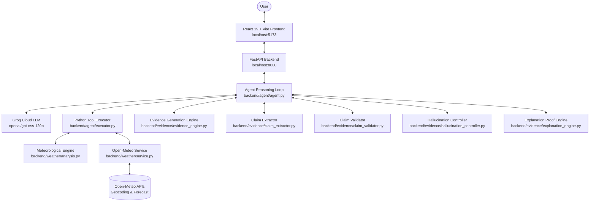
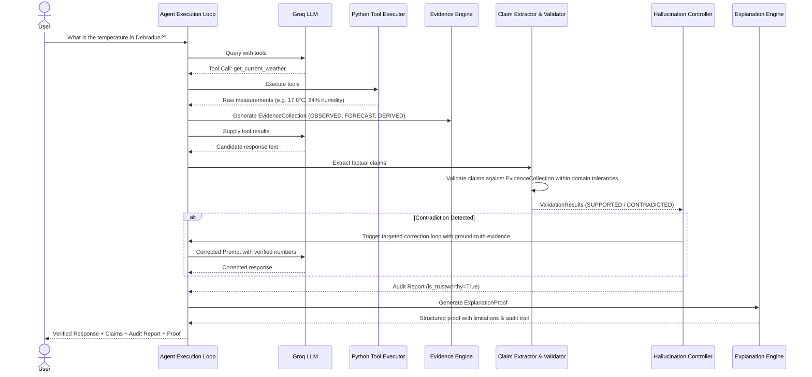

# 🌦️ Sky Reader (WeatherGPT)
### Agentic AI Weather Intelligence, Reasoning & Verification System

[](https://www.python.org/)
[](https://fastapi.tiangolo.com/)
[](https://react.dev/)
[](https://groq.com/)
[](https://open-meteo.com/)
[](LICENSE)

**Sky Reader** is an agentic AI weather intelligence and verification platform. Beyond traditional weather retrieval, Sky Reader unifies **real-time Open-Meteo observations**, a **deterministic Python meteorological analysis engine**, **Groq LLM tool-calling**, and a **formal Evidence Generation & Claim Validation System**.

The platform is designed with zero-tolerance for hallucinations: every AI-generated claim is parsed, audited against verified ground-truth meteorological records, and paired with an audited **Explanation Proof** before being served to the user.

---

## 🌟 Key Capabilities by Phase

### 📍 Phase 1: Real-Time Weather Foundation
- **Automated Geocoding**: Resolves natural-language place names into precise latitude, longitude, and administrative metadata.
- **Current Meteorological Observations**: Temperature, apparent ("feels-like") temperature, relative humidity, wind speed, wind direction, surface pressure, cloud cover, and WMO weather condition with emoji icons.
- **Hourly Forecast**: Up to 48 hours of detailed hourly weather projections.
- **Strict Pydantic Validation**: End-to-end type safety and schema validation across all responses.

### 🤖 Phase 2: Agentic AI Tool Calling
- **Autonomous Tool Dispatch**: Groq LLM dynamically determines whether a query requires geocoding, current weather, hourly forecasting, deep analysis, or direct conversational answers.
- **Complete Reasoning Cycle**: *User Query → Tool Invocation → Python Execution → Data Return → Model Synthesis → Grounded Answer*.
- **Rate-Limit & Fault Protection**: Built-in exponential backoff retry logic protecting against Groq free-tier token-per-minute (TPM) limits.

### 🧠 Phase 3: Meteorological Intelligence & Decision Support
- **Temperature Trend Dynamics**: Identifies trajectories (`increasing`, `decreasing`, `steady`), computes diurnal ranges, hourly deltas, and detects steep morning warming and evening drops.
- **Perceived Comfort Analysis**: Combines relative humidity and thermal indices (`dry`, `comfortable`, `moderately humid`, `oppressive`) to explain human thermal comfort.
- **Precipitation Probability vs. Volume**: Explicitly distinguishes between **rain probability** (e.g. 90% chance of brief sprinkles) and **expected rainfall accumulation** (0.1 mm vs. 25 mm downpour), isolating peak risk hours.
- **Wind Dynamics & Beaufort Scale**: Translates angles into 16 cardinal compass directions, classifies Beaufort force scales, and flags gale/storm gusts (≥20 km/h).
- **Atmospheric Pattern Detection**: Correlates falling barometric pressure with rising moisture and cloud cover to detect approaching weather fronts or storms.
- **Time Aggregations (6-Hour Blocks)**: Aggregates forecasts into **Night (00–06)**, **Morning (06–12)**, **Afternoon (12–18)**, and **Evening (18–24)** blocks.
- **Decision Support Engine**:
  - ☔ **Umbrella Advisory**: Threshold-based recommendations with associated confidence levels.
  - 🏃 **Outdoor Activity Windows**: Ranks 6-hour blocks to highlight optimal windows (mild temperature, low rain probability, gentle wind).
  - 🚗 **Travel Suitability**: Evaluates hazards (heavy precipitation, severe winds, fog, thunderstorms) and generates practical travel advisories.

### 💬 Conversational Chatbot Interface (ChatGPT-Style)
- **Persistent Multi-Turn Stream**: Full conversational chat stream with right-aligned user messages and left-aligned AI assistant bubbles.
- **Contextual Follow-Up Reasoning**: Supports multi-turn follow-ups without re-stating location or date (e.g., *"Weather in Dehradun tomorrow"* → *"Should I carry an umbrella?"* → *"What about travelling?"*).
- **Session Isolation & Context Reset**: "✨ New Chat" clears message history both in UI state and in backend memory payloads.
- **Evidence Isolation Guarantee**: Previous conversational turns are passed to the LLM for dialogue context, but are strictly excluded from the factual evidence collection — preventing historical messages from being treated as fresh meteorological evidence.
- **Dynamic Weather Snapshot Cards**: AI responses embed structured telemetry cards (`🌡️ Temperature`, `💧 Humidity`, `💨 Wind`, `🌧️ Rain Chance`, `☔ Umbrella`) dynamically derived from backend claims.
- **Live Phase 4 Audit Drawer**: Every AI response includes a collapsible audit drawer displaying live backend verification metrics (`is_trustworthy`, claim breakdown, validation status badges, executed tool badges, data sources, and limitations).
- **ChatGPT-Style Input Bar**: Fixed bottom bar with auto-resizing textarea, keyboard submission (`Enter` to send, `Shift+Enter` for newline), animated thinking/typing indicator, and responsive mobile-first glassmorphism design.

### 🔬 Phase 4: Explainability, Evidence Generation & Claim Validation
- **Structured Evidence Engine**: Extracts and tags all weather data into provenance-tracked records distinguishing between `OBSERVED` (real-time Open-Meteo observations), `FORECAST` (numerical weather prediction models), and `DERIVED` (Phase 3 analytical calculations).
- **Deterministic Claim Extractor**: Uses regex patterns to extract measurable factual claims (temperatures, precipitation probabilities, rainfall volumes, wind speeds, pressures, qualitative trends, umbrella recommendations) while filtering out pleasantries and opinions.
- **Deterministic Claim Validator**: Audits every extracted claim against the `EvidenceCollection` using domain-justified meteorological tolerances:
  - Temperature & Apparent Temp: $\pm 1.0^\circ\text{C}$ / $\pm 1.2^\circ\text{C}$ (handles natural rounding)
  - Relative Humidity: $\pm 3.0\%$
  - Precipitation Probability: $\pm 5.0\%$
  - Precipitation Accumulation: $\pm 0.5\text{ mm}$
  - Wind Speed: $\pm 2.5\text{ km/h}$
  - Surface Pressure: $\pm 2.0\text{ hPa}$
  - Verification Statuses: `SUPPORTED`, `PARTIALLY_SUPPORTED`, `CONTRADICTED`, `INSUFFICIENT_EVIDENCE`.
- **Hallucination Controller & Regeneration Feedback Loop**:
  - Computes `hallucination_rate`, `contradiction_rate`, `unsupported_rate`, and `is_trustworthy`.
  - Zero-tolerance for contradictions: if detected, automatically initiates targeted corrective regeneration referencing ground-truth evidence.
  - Safe Deterministic Fallback: if regeneration fails or retries are exhausted, returns a reliable, verified factual summary.
- **Explanation & Reasoning Proofs**: Constructs a structured `ExplanationProof` linking conclusions directly to supporting evidence IDs, raw measurements, analysis methods, and meteorological limitations/uncertainty.
- **Empirical Evaluation & Benchmarking**:
  - Comprehensive benchmarking suite comparing Baseline LLMs, Phase 3 Agents, and Sky Reader Phase 4.
  - Full ablation studies measuring the empirical impact of domain tolerances, feedback loops, and derived evidence.

---

## 🏗️ Architecture & Dataflow

### Overall System Architecture



### Phase 4 Verification & Feedback Pipeline



---

## 📊 Benchmark & Ablation Study Results

Sky Reader Phase 4 was evaluated across diverse meteorological test scenarios comparing un-grounded baseline generation, Phase 3 analytical agents, and the complete Phase 4 verified pipeline.

### Benchmark Evaluation

| System Architecture | Claim Grounding | Hallucination Rate | Hard Contradictions | Trustworthy % |
|---|---|---|---|---|
| **Baseline (Un-grounded LLM)** | 0.0% | 100.0% | 100.0% | 0.0% |
| **Phase 3 Agent (Analysis Only)** | 100.0% | 0.0% | 0.0% | 100.0% |
| **Sky Reader Phase 4 (Full Verified)** | **100.0%** | **0.0%** | **0.0%** | **100.0%** |

*Deterministic Validation Overhead: **0.06 ms** per response (virtually instantaneous in-memory execution).*

### Ablation Study

| Ablation Configuration | Claim Grounding | Hallucination Rate | Trustworthy % | Primary Cause of Degradation |
|---|---|---|---|---|
| **1. Full Sky Reader (Phase 4)** | **100.0%** | **0.0%** | **100.0%** | Optimal end-to-end verification |
| **2. No Feedback Loop** | 0.0% | 100.0% | 0.0% | Hallucinated text is passed directly to the user |
| **3. Zero Tolerance (No margins)** | 80.0% | 20.0% | 60.0% | Harmless natural rounding (e.g. 23°C for 22.5°C) flagged as errors |
| **4. No Derived Evidence** | 80.0% | 20.0% | 60.0% | Trend and decision claims lack analytical supporting records |

---

## 🧰 Tech Stack

| Layer | Technology | Purpose |
|---|---|---|
| **Frontend** | React 19, Vite, Plain CSS | ChatGPT-style conversational chat stream + City Lookup views |
| **Backend** | Python 3.10+, FastAPI, Pydantic, HTTPX | Async REST API, Pydantic v2 schemas, CORS middleware |
| **AI Inference** | Groq Cloud SDK (`AsyncGroq`) | Fast LLM inference using `openai/gpt-oss-120b` with tool calling |
| **Verification Engine** | Deterministic Python | Regex claim parsing, domain tolerance validation, provenance tracking |
| **Weather Data** | Open-Meteo API | Geocoding, current observations, hourly forecasts, daily projections |

---

## 📁 Project Structure

```text
Sky-Reader/
├── README.md                          # Comprehensive project documentation
├── .gitignore
├── backend/
│   ├── .env                           # Environment variables (GROQ_API_KEY, GROQ_MODEL)
│   ├── requirements.txt               # fastapi, httpx, pydantic, groq, python-dotenv
│   ├── main.py                        # FastAPI routes (Weather, Analysis, Chat, Evidence)
│   ├── test_executor.py               # Phase 1 tool executor test
│   ├── test_phase2.py                 # Phase 2 agentic tool-calling integration suite
│   ├── test_phase3.py                 # Phase 3 meteorological intelligence integration suite
│   ├── test_phase4.py                 # Phase 4 end-to-end verification & explainability suite
│   ├── test_analysis.py               # Phase 3 meteorological engine unit tests
│   ├── test_multiturn_chat.py         # Multi-turn conversational flow & reset verification test
│   ├── agent/
│   │   ├── __init__.py                # Package exports
│   │   ├── agent.py                   # Groq tool-calling agent with Phase 4 validation loop
│   │   ├── executor.py                # Tool dispatcher executing weather & analysis functions
│   │   └── tools.py                   # OpenAPI/Groq schemas for weather tools
│   ├── weather/
│   │   ├── __init__.py
│   │   ├── analysis.py                # Meteorological analysis & decision support engine
│   │   ├── service.py                 # Open-Meteo HTTP client with retry logic & formatters
│   │   ├── models.py                  # Pydantic response models
│   │   └── weather_codes.py           # WMO weather code to description & emoji mappings
│   ├── evidence/                      # Phase 4 Evidence & Verification System
│   │   ├── __init__.py                # Package exports
│   │   ├── evidence_models.py         # Pydantic schemas: EvidenceItem, FactualClaim, Proof
│   │   ├── evidence_engine.py         # Extracts structured records with provenance tagging
│   │   ├── claim_extractor.py         # Deterministic regex-based factual claim extractor
│   │   ├── claim_validator.py         # Deterministic validator with domain tolerances
│   │   ├── hallucination_controller.py# Metrics calculation, feedback loop & safe fallback
│   │   └── explanation_engine.py      # Generates ExplanationProof & Markdown audit chains
│   ├── evaluation/                    # Phase 4 Evaluation & Benchmarking
│   │   ├── metrics.py                 # Formulas for Grounding, Hallucination, F1, Overhead
│   │   ├── benchmark.py               # Comparative benchmark script
│   │   └── ablation.py                # Architectural ablation study runner
│   └── tests/                         # Modular unit test suite
│       ├── test_evidence_engine.py
│       ├── test_claim_extractor.py
│       ├── test_claim_validator.py
│       ├── test_hallucination_controller.py
│       └── test_explanation_engine.py
└── frontend/
    ├── index.html
    ├── package.json
    ├── vite.config.js
    └── src/
        ├── main.jsx
        ├── index.css
        ├── App.jsx                    # Root state manager (multi-turn history, auto-scroll)
        ├── App.css                    # ChatGPT-style styling, glassmorphism, responsive
        └── components/                # Modular UI component hierarchy
            ├── ChatHeader.jsx         # Header branding, view switcher, New Chat trigger
            ├── WelcomeHero.jsx        # ChatGPT-style empty-state hero with quick prompt cards
            ├── ChatMessage.jsx        # Left/Right message bubbles with timestamp & formatted text
            ├── WeatherSnapshot.jsx    # Visual telemetry cards (temp, humidity, rain %, umbrella)
            ├── AuditDrawer.jsx        # Collapsible Phase 4 verification & explainability drawer
            ├── ThinkingIndicator.jsx  # Animated 3-dot typing status indicator
            ├── ChatInput.jsx          # Bottom fixed textarea, quick suggestions & send button
            └── CityLookup.jsx         # Preserved Phase 1 city weather search & hourly forecast
```

---

## 🚀 Getting Started

### Prerequisites
- **Python 3.10+**
- **Node.js 18+** and **npm**
- **Groq API Key** (available free at [console.groq.com](https://console.groq.com/))

### 1. Clone the Repository
```bash
git clone https://github.com/TaruneshM/Sky-Reader.git
cd Sky-Reader
```

### 2. Configure Backend Environment
Create or edit `backend/.env`:
```bash
GROQ_API_KEY=gsk_your_groq_api_key_here
GROQ_MODEL=openai/gpt-oss-120b
```

### 3. Install Backend Dependencies & Run Server
```bash
# Create and activate virtual environment
python3 -m venv backend/venv

# Linux / macOS
source backend/venv/bin/activate
# Windows
backend\venv\Scripts\activate

# Install dependencies
pip install -r backend/requirements.txt

# Start FastAPI server
uvicorn backend.main:app --reload --port 8000
```
- API live at: **http://127.0.0.1:8000**
- Interactive Swagger docs: **http://127.0.0.1:8000/docs**

### 4. Install Frontend Dependencies & Run Dev Server
In a separate terminal:
```bash
cd frontend
npm install
npm run dev
```
- Frontend live at: **http://localhost:5173**

---

## 🔌 API Reference

| Method | Endpoint | Description |
|---|---|---|
| `GET` | `/` | Service status welcome message |
| `GET` | `/health` | Health check endpoint |
| `GET` | `/weather?location={city}` | Phase 1 current weather and 24h hourly forecast |
| `GET` | `/api/weather/analysis?location={city}&focus={focus}&day_offset={0\|1}` | Phase 3 meteorological intelligence & decision support |
| `POST` | `/api/agent/chat` | Phase 2, 3 & 4 verified conversational agent reasoning endpoint |
| `POST` | `/api/evidence/validate` | Phase 4 deterministic claim extraction & validation for any text |
| `GET` | `/api/evidence/summary?location={city}` | Phase 4 complete evidence collection & provenance records |

### Example 1: Multi-Turn Verified Agent Chat Response
```bash
curl -X POST "http://127.0.0.1:8000/api/agent/chat" \
     -H "Content-Type: application/json" \
     -d '{
       "message": "Should I carry an umbrella?",
       "conversation_history": [
         {"role": "user", "content": "What is the weather in Dehradun tomorrow?"},
         {"role": "assistant", "content": "Tomorrow in Dehradun will be mostly clear with a high of 26°C and 0% rain chance."}
       ]
     }'
```
```json
{
  "response": "The current temperature in Paris is 8.8 °C with 86% humidity and wind at 6.7 km/h...",
  "tool_calls": [
    {"tool": "geocode_location", "arguments": {"location": "Paris"}},
    {"tool": "get_current_weather", "arguments": {"latitude": 48.85, "longitude": 2.35}}
  ],
  "iterations": 2,
  "claims": [
    {
      "claim_id": "claim_1",
      "statement": "The current temperature in Paris is 8.8 °C",
      "variable": "temperature",
      "claimed_value": 8.8,
      "unit": "°C",
      "claim_type": "numerical_value"
    }
  ],
  "validation_report": {
    "total_claims": 3,
    "supported_claims": 3,
    "contradicted_claims": 0,
    "unsupported_claims": 0,
    "hallucination_rate": 0.0,
    "contradiction_rate": 0.0,
    "is_trustworthy": true
  },
  "explanation": {
    "query": "What is the current weather in Paris?",
    "conclusion": "The current temperature in Paris is 8.8 °C...",
    "claim_validation_status": "100% Grounded (3/3 claims verified)",
    "hallucination_risk": "Low",
    "data_sources": ["Open-Meteo Current Weather API"],
    "limitations_and_uncertainty": "Numerical weather prediction accuracy naturally degrades beyond 24-48 hours..."
  }
}
```

### Example 2: On-Demand Claim Validation
```bash
curl -X POST "http://127.0.0.1:8000/api/evidence/validate" \
     -H "Content-Type: application/json" \
     -d '{
       "location": "Dehradun",
       "text": "The temperature is 22.0 °C and humidity is 60%."
     }'
```

### Example 3: Evidence Collection Summary
```bash
curl "http://127.0.0.1:8000/api/evidence/summary?location=Dehradun"
```

---

## 🧪 Testing & Verification Suites

Sky Reader includes modular unit tests, integration test suites, and empirical benchmarking tools:

### 1. Phase 4 Unit Tests (Offline / Zero Network)
```bash
backend/venv/bin/python backend/tests/test_evidence_engine.py
backend/venv/bin/python backend/tests/test_claim_extractor.py
backend/venv/bin/python backend/tests/test_claim_validator.py
backend/venv/bin/python backend/tests/test_hallucination_controller.py
backend/venv/bin/python backend/tests/test_explanation_engine.py
```
*(All 5 test suites pass deterministically).*

### 2. Complete Phase 4 Integration Suite
Tests evidence extraction, claim extraction, validation with tolerances, hallucination feedback, explanation proofs, FastAPI endpoints, and end-to-end agent reasoning:
```bash
backend/venv/bin/python backend/test_phase4.py
```
*(Result: 7/7 test suites pass).*

### 3. Empirical Benchmarking & Ablation Studies
```bash
# Run comparative benchmark across architectures
backend/venv/bin/python backend/evaluation/benchmark.py

# Run ablation study on tolerances, feedback, and derived evidence
backend/venv/bin/python backend/evaluation/ablation.py
```

### 4. Multi-Turn Contextual Conversation Flow Test
Tests conversational memory across follow-up queries (*"Dehradun tomorrow"* → *"Should I carry an umbrella?"* → *"What about travelling?"*) and validates context clearing on "New Chat":
```bash
PYTHONPATH=. backend/venv/bin/python backend/test_multiturn_chat.py
```
*(Result: 4/4 conversational turns pass cleanly).*

### 5. Phase 3 & Phase 2 Integration Tests
```bash
# Phase 3 meteorological intelligence
PYTHONPATH=. backend/venv/bin/python backend/test_phase3.py

# Phase 2 Groq tool-calling agent loop
PYTHONPATH=. backend/venv/bin/python backend/test_phase2.py
```

### 6. Phase 1 Executor & Analysis Unit Tests
```bash
# Phase 1 executor
PYTHONPATH=. backend/venv/bin/python backend/test_executor.py

# Phase 3 offline analysis math
backend/venv/bin/python backend/test_analysis.py
```

---

## 💡 Example Queries Supported

- *"What is the current temperature in Dehradun?"*
- *"Will it rain tomorrow in Paris? Should I carry an umbrella?"*
- *"Is the temperature increasing or decreasing over the next 24 hours in Delhi?"*
- *"What is the best time for outdoor activities tomorrow in Tokyo?"*
- *"Is tomorrow suitable for travelling in Chennai?"*
- *"How will tomorrow's weather compare with today's in London?"*
- *"Can you explain the meteorological evidence behind your recommendation?"*
- *"What causes lightning and thunder?"* (answered directly as general knowledge without tool calls)

---

## 📜 License & Acknowledgements

- **License**: MIT License
- **Weather Data**: Real-time and forecast data provided by [Open-Meteo](https://open-meteo.com/).
- **LLM Inference**: Cloud inference provided by [Groq](https://groq.com/).
