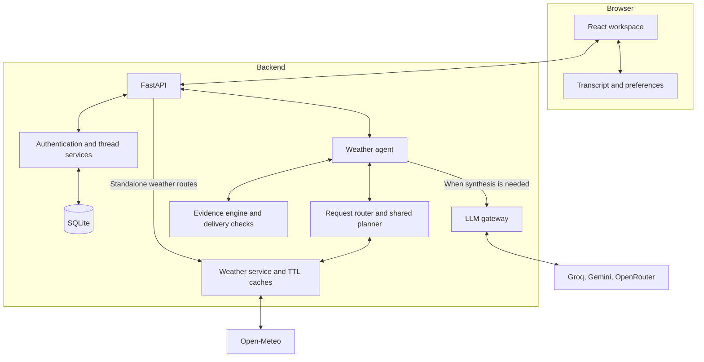
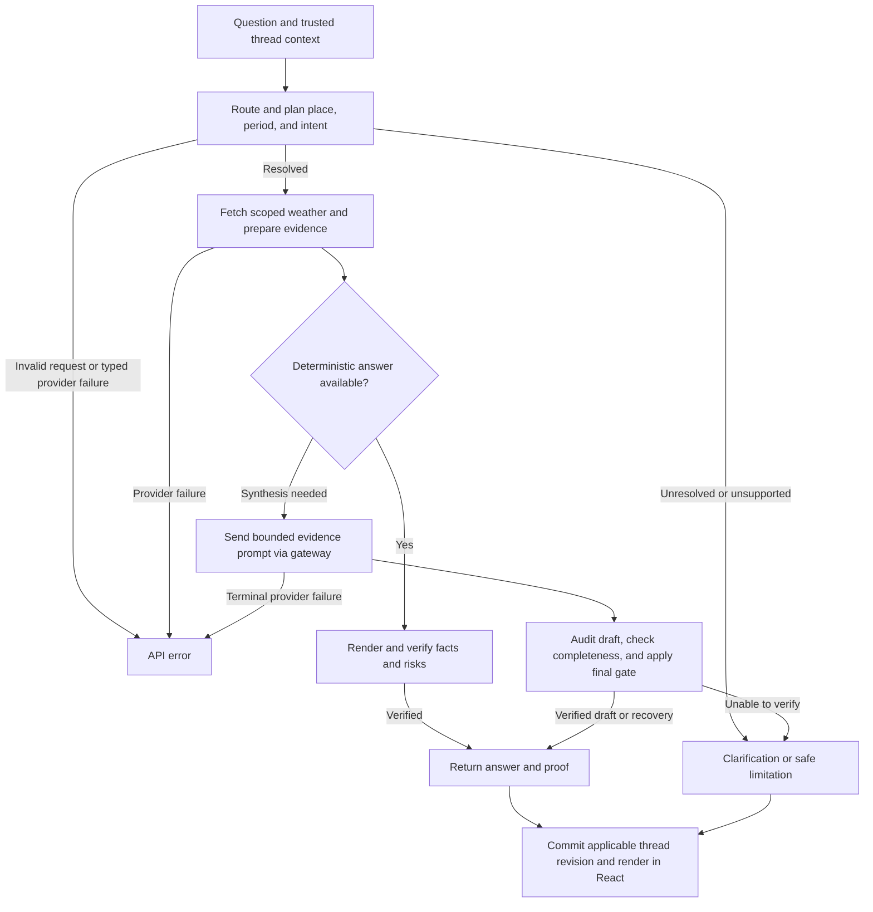
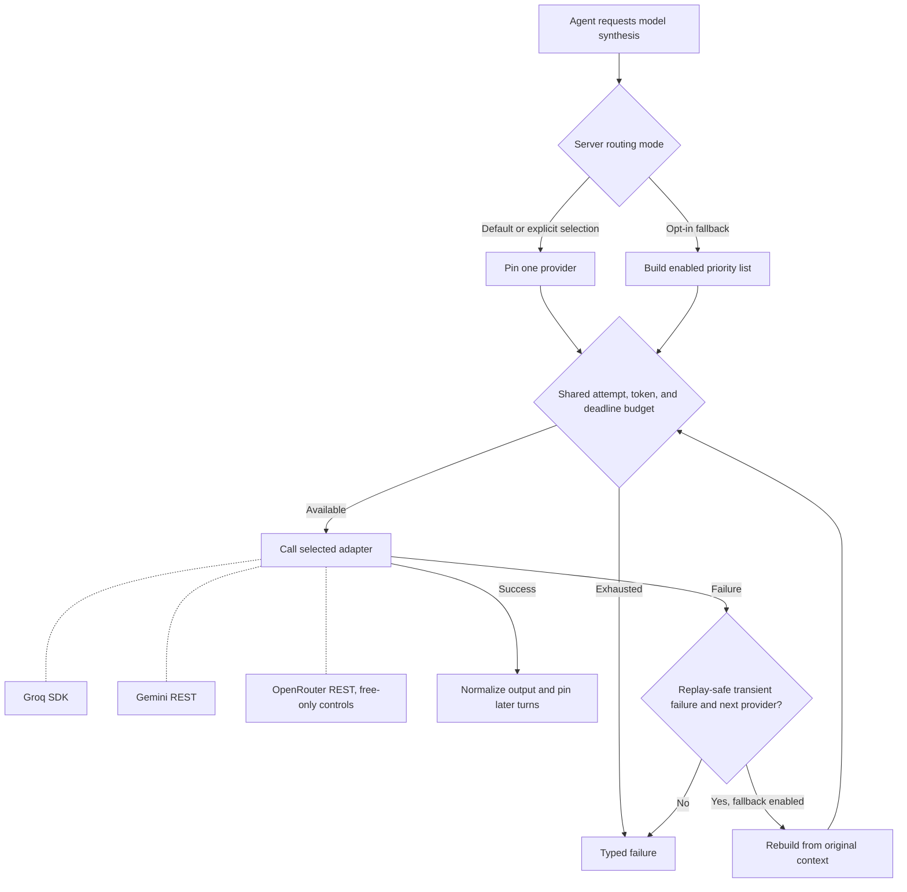
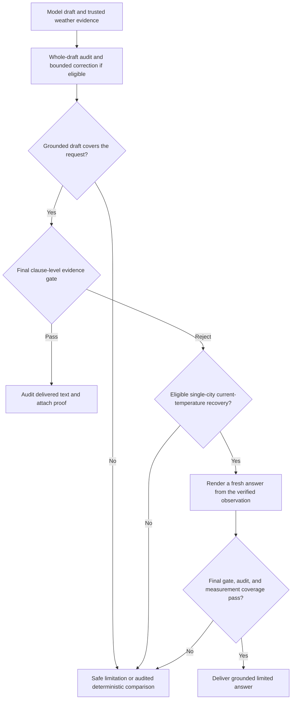
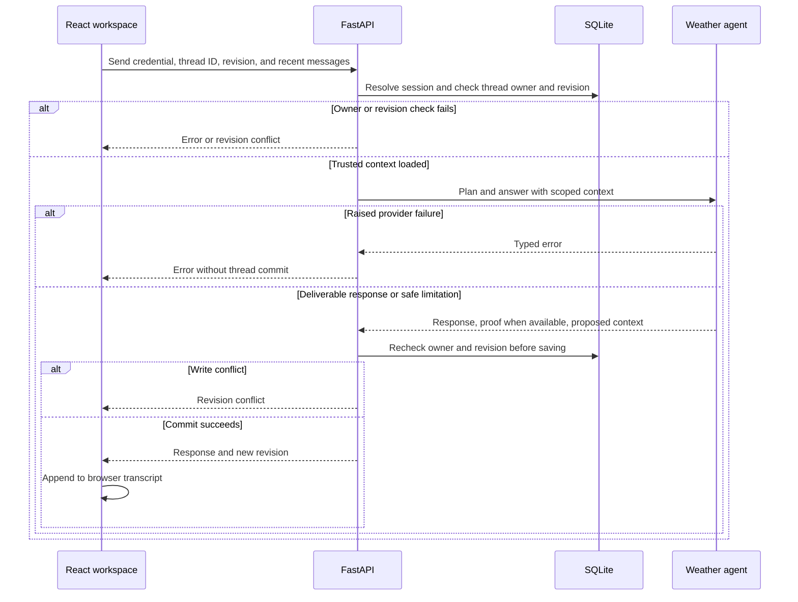

<h1 align="center">Sky Reader</h1>

<p align="center"><strong>Evidence-grounded agentic weather intelligence</strong></p>

<p align="center">
  Ask about current conditions, plan around a forecast, or compare two destinations.
  Sky Reader resolves places and local forecast windows, then checks weather claims against their sources before delivery.
</p>

<p align="center">
  
  
  
  
  
</p>

<p align="center">
  <a href="#architecture">Architecture</a> ·
  <a href="#multi-provider-llm-gateway">Provider gateway</a> ·
  <a href="#local-development">Quickstart</a> ·
  <a href="#testing-and-evaluation">Evaluation</a> ·
  <a href="#implementation-status">Status</a>
</p>

## Key capabilities

| Capability | What it supports |
| --- | --- |
| Weather chat and city lookup | Current observations, supported local forecast windows, and follow-ups that use confirmed context |
| Comparisons and planning | Supported destination pairs and relative time windows, with clothing, outdoor activity, and weather-risk guidance |
| Evidence and provenance | Claim statuses, supporting measurements, source information, and applicable risk findings in the workspace |
| Account and guest workspaces | Scoped browser transcripts and server-side thread context with revision checks |

## Why Sky Reader

Sky Reader uses a weather-specific planner to connect conversational questions to Open-Meteo measurements. It can answer supported requests directly from prepared facts, or use a language model to synthesize a more detailed explanation. It checks whether each answer is grounded and whether it covers the question before returning it.

The model gateway separates provider mechanics from weather planning and verification. Server configuration controls provider selection, and optional fallback shares a single request budget across providers.

## Architecture

React hosts the chat, city lookup, session controls, and audit views. FastAPI validates requests and exposes standalone weather, analysis, risk, and evidence routes. The chat agent coordinates the planner, weather service, evidence engine, and model gateway.



## Request pipeline

The router extracts the intent, requested measurements, place, period, and relevant activity. The planner uses verified thread context for follow-ups. Typed geocoding distinguishes resolved, ambiguous, missing, and unavailable results, using explicit qualifiers and geocoder metadata to rank candidates. Weather lookups use confirmed coordinates and destination-local forecast windows. Geocoding, current weather, hourly forecasts, and daily forecasts have separate process-local caches.

The agent can render supported observations, forecasts, comparisons, and guidance deterministically. For model synthesis, it builds a compact evidence packet scoped to each destination and period, while retaining the original weather payload for verification.



## Multi-provider LLM gateway

| Provider | Adapter and controls | Verification status |
|---|---|---|
| Groq | Default adapter and default model `openai/gpt-oss-120b`. Existing SDK calls are normalized into bounded assistant messages. | One Stage 1.7D live synthesis passed. |
| Gemini | Google GenerateContent REST adapter. Tool state and supported thought signatures remain request-local and provider-specific. | Mocked adapter and fallback coverage. Live HTTP 404. |
| OpenRouter | Chat Completions REST adapter. Explicit free-model allowlist, zero prompt and completion price ceilings, and provider-side fallback disabled. | Mocked adapter and fallback coverage. Live HTTP 404. |

Provider selection is configured on the server or set explicitly by a backend caller. Fallback is off by default. Eligible failures include throttling, selected service errors, clear connection failures, and timeouts on the first replay-safe model turn. Authentication, malformed output, evidence rejection, and exhausted budgets do not trigger migration. Later tool turns and corrections remain pinned to the responding provider. Normal chat weather retrieval is planner-owned; tool schemas remain available to the injected executor compatibility path.

All model attempts share request-local token reservations, attempt counts, round and correction caps, and a monotonic model deadline. Reported usage reconciles estimates. Omitted usage remains unknown. See the [gateway configuration and limits](backend/llm_gateway/README.md).



## Evidence verification and safety

The evidence engine represents observations, forecast points, and derived findings separately. Evidence items carry a city, period, units, source, and ID. The whole-draft audit checks extracted claims against those items. Completeness checks whether the supported claims cover the requested measurements, city, period, and relevant hazards or advice.

The final gate checks individual weather-shaped clauses, including statements the claim extractor may have missed. Stage 1.7E can establish an anchor from an audited explicit-city observation and use it for supported continuations such as humidity, apparent temperature, and wind. Inherited claims still require matching measurements, units, location, and time scope. Ambiguous cities, mixed observation and forecast scope, and unclassified prose constrain inheritance.



## Grounded recovery and graceful degradation

When a prepared single-city current-temperature draft fails the final gate, recovery can render a fresh city-explicit answer from exactly one verified observation. Sky Reader rechecks the replacement without another LLM call. The answer states that the detailed explanation could not be verified, and the explanatory completeness result remains false. Compound, multi-city, forecast, and safety requests are outside this recovery path.

The planner can ask for a location clarification or explain forecast limits. Typed provider failures can exit without a successful thread write.

## Conversations and persistence

React maintains the visible transcript and preferences in browser storage. SQLite keeps account and session records plus structured thread state, including confirmed places, comparison slots, and applicable forecast windows. Account or guest identity scopes the thread, and revision checks guard against stale writes both before planning and at commit.



## Technology stack

| Layer | Technology |
|---|---|
| Frontend | React 19, Vite, JavaScript, CSS, Lucide icons |
| API and application models | Python, FastAPI, Pydantic, HTTPX |
| Weather | Open-Meteo geocoding and forecast APIs, process-local TTL caches |
| LLM | Groq SDK, Gemini REST, OpenRouter Chat Completions |
| Evidence | Python claim extraction, validation, completeness checks, and proof metadata |
| Persistence | SQLite for account/session and thread context, browser storage for the UI transcript |
| Verification | pytest, Node test runner, ESLint, Vite build, mocked provider and frozen evaluation suites |

## Local development

Use Python 3.12 and a supported Node.js LTS release at or above 22.12 for the following workflow. The examples use a POSIX shell.

### 1. Clone and install backend dependencies

```bash
git clone https://github.com/TaruneshM/Sky-Reader.git
cd Sky-Reader
python3.12 -m venv backend/venv
source backend/venv/bin/activate
python -m pip install -r backend/requirements.txt
```

On Windows, activate the environment using the script in `backend\venv\Scripts` appropriate to your shell.

### 2. Configure the backend

Open-Meteo and eligible deterministic weather paths require no LLM credentials. For model-assisted synthesis with the default provider, create the ignored `backend/.env` file locally and replace the placeholder with your Groq key.

```dotenv
GROQ_API_KEY=<your-groq-api-key>
```

Server process variables also work. Store credentials only in backend configuration. Optional settings include `GROQ_MODEL`, `LLM_PROVIDER`, `LLM_ENABLED_PROVIDERS`, `LLM_FALLBACK_ENABLED`, and `LLM_PROVIDER_ORDER`. Secondary-provider configuration requires explicit model and key settings through `GEMINI_MODEL` and `GEMINI_API_KEY`, or `OPENROUTER_MODEL` and `OPENROUTER_API_KEY`. See the [gateway configuration guide](backend/llm_gateway/README.md).

### 3. Start FastAPI

From the repository root with the virtual environment active:

```bash
python -m uvicorn backend.main:app --reload --host 127.0.0.1 --port 8000
```

The API provides [interactive docs](http://127.0.0.1:8000/docs) and a [health route](http://127.0.0.1:8000/health).

### 4. Start React

In a second terminal from the repository root:

```bash
cd frontend
npm ci
npm run dev -- --host 127.0.0.1 --port 5173 --strictPort
```

Open [127.0.0.1:5173](http://127.0.0.1:5173). The frontend uses `http://127.0.0.1:8000` for API requests. FastAPI allows the default local Vite origins on port 5173. See the [frontend guide](frontend/README.md).

### API surface

| API routes | Purpose |
|---|---|
| `POST /api/agent/chat` | Chat with optional thread identity and expected revision |
| `GET /weather` | Standalone city lookup and weather |
| `GET /api/weather/analysis`, `GET /api/weather/risks` | Weather analysis and risk assessment |
| `POST /api/evidence/validate`, `GET /api/evidence/summary` | Standalone claim validation and evidence inspection |
| `/api/auth/*`, `/api/guest/session`, `/api/chat/threads` | Account, guest, and thread lifecycle |

## Testing and evaluation

Install `pytest` into the activated backend environment for offline regression work. Run the backend and frozen suite from the repository root with mocked providers. On a memory-constrained Linux host, use a verified cgroup with `MemoryHigh=512M`, `MemoryMax=768M`, and `MemorySwapMax=0`, and run checks sequentially with a bounded timeout. Avoid legacy live integration scripts when verifying offline.

```bash
python -m pip install pytest
GROQ_API_KEY= GEMINI_API_KEY= OPENROUTER_API_KEY= python -m pytest \
  backend/tests backend/test_analysis.py backend/test_phase4.py
GROQ_API_KEY= GEMINI_API_KEY= OPENROUTER_API_KEY= python -m backend.evaluation.stage163.run \
  --output /tmp/skyreader-stage163-results.json
```

From the frontend directory:

```bash
npm test
npm run lint
npm run build
```

The table reports **Stage 1.7E offline verification**. The focused batch overlaps the backend suite.

| Check | Offline result |
| --- | ---: |
| Backend regression | 395 passed |
| Focused regression | 79 passed |
| Frozen evaluation size | 120 cases |
| Answer completeness | 101/120 |
| Required hazard coverage | 12/12 |
| Both-city measurement coverage | 7/8 |
| Grounded audited outputs | 88/88 |
| Unaudited numerical weather answers | 0 |

These results describe specific mocked fixtures and scoring denominators. The [frozen evaluation report](backend/evaluation/stage163/REPORT.md) documents the corpus and rubric. The [evaluation subsystem guide](backend/evaluation/README.md) describes the historical benchmark tooling.

## Implementation status

| Area | Milestone and verification |
| --- | --- |
| Multi-provider gateway | Implemented. Opt-in sequential fallback is mock-tested. |
| Groq live synthesis | One approved Stage 1.7D run using a fixed Lisbon observation passed the whole-draft audit, final evidence gate, and delivered-answer completeness without recovery. See the [live report](backend/evaluation/stage17c/17D-GROQ-LIVE-REPORT.md). |
| Grounded recovery | Stage 1.7D implementation is mock-tested. |
| Semantic evidence gate | Stage 1.7E observation anchors and continuations are offline verified. |
| Gemini and OpenRouter | The approved production-adapter requests returned HTTP 404. Live generation remains unresolved. See the [diagnostic retest](backend/evaluation/stage17c/DIAGNOSTIC-RETEST-REPORT.md) and [root-cause investigation](backend/evaluation/stage17c/FIX2-REPORT.md). |

Responses are limited by available forecasts, geocoder coverage, provider model access, and quotas. Conservative clause validation can withhold a draft that contains some supported facts. The live Groq result covers one synthesis sample. Broader production reliability and high-severity live weather coverage remain unverified.

## Development roadmap

1. Diagnose Gemini model access and OpenRouter free-route availability.
2. Expand representative end-to-end reliability and live hazard coverage.
3. Use the regression corpus and approval-gated validation harnesses to verify changes to routing, evidence coverage, and provider integration.

The [architecture audit](backend/evaluation/stage17c/ARCHITECTURE-AUDIT.md) documents the findings behind Stage 1.7D and Stage 1.7E.

## Project structure

```text
Sky-Reader/
├── backend/
│   ├── main.py                  FastAPI endpoints and API contracts
│   ├── database.py              SQLite schema, account and session operations
│   ├── conversation_store.py    Thread ownership, revisions and persisted context
│   ├── agent/                   Routing, planner, state, prompts, budgets and final gate
│   ├── weather/                 Open-Meteo clients, caches, models, analysis and risk
│   ├── evidence/                Evidence items, claim extraction, audit and proof
│   ├── llm_gateway/             Provider configuration, adapters and normalized messages
│   ├── evaluation/              Historical benchmarks, frozen suite and live harnesses
│   ├── tests/                   Backend regression tests
│   └── requirements.txt
└── frontend/
    ├── src/
    │   ├── App.jsx              Workspace composition and API origin
    │   ├── components/          Chat, city lookup, audit, risk and preferences
    │   └── utils/               Auth session, chat threads and browser persistence
    ├── tests/                   Node-based frontend regressions
    └── package.json
```
