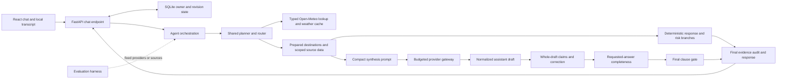

# Sky Reader architecture audit

## Summary

The repeated Lisbon failures expose a **mismatch between the evidence accepted for a draft and the context required to deliver that draft**. The whole-draft auditor can use the single-city evidence collection's default location and can ignore prose that its extractor does not recognize. The delivery gate independently segments the answer, requires each factual clause to establish or inherit location under a narrow grammar, and rejects weather-shaped assertions that escape extraction. Completeness runs between those stages and therefore cannot guarantee deliverability.

The latest live record identifies a specific state transition: clause 2 was skipped by the clause auditor, the location anchor was cleared, and clause 3 had no explicit evidence-location match. Clause 3 also failed the numeric continuation grammar. Keeping the anchor across clause 2 alone would therefore still reject that draft under the current rules. The clause text was never retained. The record cannot establish whether clause 3 was supportable, a formatting artifact, or an unsupported assertion. The audit confirms the mechanism with independent synthetic examples without reconstructing the historical prose. [FIX4 live report](FIX4-GROQ-LIVE-REPORT.md) · [Sanitized record](fix4-groq-results.json)

## Architecture

The FastAPI entry point defines chat, session, thread lifecycle, standalone weather, analysis, risk, and evidence endpoints. The standalone weather and evidence routes have their own fetch and validation paths. They do not invoke the chat model-draft gate. The frontend chat remains a separate consumer of published text and audit metadata. Browser transcripts and SQLite planner context are separate stores. [backend/main.py:83](../../main.py#L83) · [backend/main.py:224](../../main.py#L224) · [backend/main.py:374](../../main.py#L374) · [backend/main.py:506](../../main.py#L506) · [frontend/src/utils/conversations.js:138](../../../frontend/src/utils/conversations.js#L138)

## Actual Lisbon call graph

The approved prompt is **“Explain the current temperature in Lisbon, Portugal.”** The offline parser produced intent `temperature`, period `current`, explicit location `Lisbon, Portugal`, component `temperature`, and no comparison, activity, or safety request.

| Step | Executed behavior and state | Source |
|---|---|---|
| 1. Browser and API | The browser sends the question and up to six prior messages with the thread ID and expected revision. FastAPI rate-limits, loads the owner-scoped thread when supplied, validates the revision, and trims history. The legacy chat route can run without a thread. | [chatThreads.js:62](../../../frontend/src/utils/chatThreads.js#L62) · [main.py:424](../../main.py#L424) · [conversation_store.py:129](../../conversation_store.py#L129) |
| 2. Planner | `run_agent` invokes `plan_weather_request`. The router extracts intent, time, components and place. The planner uses trusted state where available, creates or resumes a task, and applies typed resolver outcomes to the applicable destination slot. Ambiguity, unavailable provider data and missing places can stop preparation without querying a model. | [agent.py:533](../../agent/agent.py#L533) · [router.py:278](../../agent/router.py#L278) · [request_planner.py:94](../../agent/request_planner.py#L94) · [conversation_state.py:198](../../agent/conversation_state.py#L198) |
| 3. Weather data | The resolver ranks candidates against explicit qualifiers and applies contextual hints only in eligible cases. The planned current path fetches Open-Meteo observations by confirmed coordinates, using a coordinate-keyed TTL cache. Forecast paths separately scope local hours and can record a verified forecast window. | [service.py:128](../../weather/service.py#L128) · [service.py:251](../../weather/service.py#L251) · [service.py:346](../../weather/service.py#L346) · [request_planner.py:224](../../agent/request_planner.py#L224) · [service.py:473](../../weather/service.py#L473) |
| 4. Prepared result | `PreparedDestination` carries slot, confirmed identity, observation versus hourly requirement, selected period, status, optional window, and serialized source payload. `Explain` matches the complex-request pattern, so this eligible current-temperature request reaches prepared synthesis. Ordinary current metric questions can instead use the deterministic branch. | [request_planner.py:40](../../agent/request_planner.py#L40) · [answer_completeness.py:6](../../agent/answer_completeness.py#L6) · [agent.py:504](../../agent/agent.py#L504) · [agent.py:680](../../agent/agent.py#L680) |
| 5. Prompt | The agent constructs a compact system evidence packet and the original user turn. The packet includes location identity, local period, observation/forecast kind, local time when present, and unit-bearing fields. The prepared path provides no tool schemas. Original weather data remains in `sources` for the audit. | [agent.py:921](../../agent/agent.py#L921) · [prepared_prompt.py:13](../../agent/prepared_prompt.py#L13) |
| 6. Dispatch | `complete` sizes the bounded normalized request, reserves output and input estimates under shared attempt and deadline limits, and dispatches through the gateway. Opt-in fallback can switch providers only on the initial replay-safe turn and eligible error. Tool turns and correction stay pinned. This Lisbon prompt uses the 350-token complexity tier. | [agent.py:120](../../agent/agent.py#L120) · [agent.py:166](../../agent/agent.py#L166) · [agent.py:377](../../agent/agent.py#L377) · [llm_budget.py:106](../../agent/llm_budget.py#L106) · [gateway.py:226](../../llm_gateway/gateway.py#L226) |
| 7. Response normalization | Groq's adapter calls the existing SDK and selects a bounded assistant-message shape, usage and finish reason. The message content remains model-authored text. Completion status and usage enter tracing. The agent's completion helper returns the normalized message. No location paraphrase or clause rewrite occurs. | [gateway.py:23](../../llm_gateway/gateway.py#L23) · [llm_budget.py:65](../../agent/llm_budget.py#L65) · [agent.py:429](../../agent/agent.py#L429) |
| 8. Build audit evidence | With no requested model tools, the agent generates evidence from original source data and verified place metadata. It prefixes item IDs with coordinates, deduplicates, and sets `EvidenceCollection.location_name` for this single-city path. | [agent.py:992](../../agent/agent.py#L992) · [evidence_engine.py:43](../../evidence/evidence_engine.py#L43) · [evidence_engine.py:94](../../evidence/evidence_engine.py#L94) |
| 9. Whole draft and completeness | `verify_and_correct` accepts a trustworthy existing draft, may spend a bounded correction on rejected claims, or generates a safe fallback. The single-city completeness check requires supported temperature evidence for Lisbon. Passing means the requested measurement is covered by the extracted claims. | [hallucination_controller.py:137](../../evidence/hallucination_controller.py#L137) · [hallucination_controller.py:192](../../evidence/hallucination_controller.py#L192) · [answer_completeness.py:33](../../agent/answer_completeness.py#L33) · [agent.py:1041](../../agent/agent.py#L1041) |
| 10. Final delivery gate | `result` rechecks a model draft through clause segmentation and location gating. A location failure occurs before the clause audit. The agent replaces rejected text with a verification limitation, clears completeness and sets `forecast_window_unavailable`, even when preparation found usable weather. It audits the replacement and constructs the proof for what it returns. The late gate does not re-enter the earlier correction loop. | [agent.py:464](../../agent/agent.py#L464) · [weather_evidence_gate.py:40](../../agent/weather_evidence_gate.py#L40) · [weather_evidence_gate.py:61](../../agent/weather_evidence_gate.py#L61) · [explanation_engine.py:27](../../evidence/explanation_engine.py#L27) |
| 11. Serialization and persistence | The API returns the final text, claims, validation/proof, tools, risk and usage. For a normal result it conditionally writes planner state after rechecking scope and revision. A grounded-answer limitation can therefore advance the revision and appear as a safe assistant reply. A raised provider error uses a typed non-success response and does not save the revision. The UI appends only the final answer from a successful response. | [main.py:457](../../main.py#L457) · [conversation_store.py:148](../../conversation_store.py#L148) · [conversations.js:160](../../../frontend/src/utils/conversations.js#L160) · [ChatMessage.jsx:199](../../../frontend/src/components/ChatMessage.jsx#L199) |

## Adjacent production paths and boundaries

- **Auth and state.** Account sessions and guest credentials resolve to owner-scoped threads. SQLite revision checks protect against stale writers and prevent a failed provider call from committing a new weather task. The client scopes local transcript storage, aborts obsolete requests, and handles revision conflicts without an automatic replay. Neither storage layer chooses the final clause's location anchor. [database.py:202](../../database.py#L202) · [conversation_store.py:58](../../conversation_store.py#L58) · [conversation_store.py:148](../../conversation_store.py#L148) · [authSession.js:39](../../../frontend/src/utils/authSession.js#L39)
- **Forecast and safety.** Observation rows are distinct from timestamped forecast rows and derived analysis/risk items. The agent uses distinct deterministic single-city, two-city, and relative-window branches. The risk engine and response renderer preserve typed hazard findings or explicitly state the evidence limitation. Comparison evidence uses per-city provenance and bound periods. [evidence_models.py:46](../../evidence/evidence_models.py#L46) · [evidence_engine.py:242](../../evidence/evidence_engine.py#L242) · [evidence_engine.py:363](../../evidence/evidence_engine.py#L363) · [agent.py:610](../../agent/agent.py#L610) · [agent.py:790](../../agent/agent.py#L790) · [risk_engine.py](../../weather/risk_engine.py)
- **Tool compatibility.** The normal prepared path retrieves weather through planner wrappers and records tool-shaped provenance. Existing injected executor callers can enter a separate tool-enabled branch. That branch validates bounded arguments, suppresses repeated signatures, formats results, and attaches evidence to recognized coordinates and scoped periods. The evaluation adapters exercise that compatibility surface. The Lisbon run never enters it. [agent.py:506](../../agent/agent.py#L506) · [agent.py:951](../../agent/agent.py#L951) · [agent.py:1085](../../agent/agent.py#L1085) · [executor.py:59](../../agent/executor.py#L59) · [evaluation/adapters.py:401](../adapters.py#L401)
- **Provider isolation.** Request normalization validates roles, tool schemas and result IDs. Gemini retains its provider-specific function metadata within its adapter, OpenRouter uses an exact free-model allowlist and zero-price limits, and fallback is restricted to replay-safe initial turns. The validators consume normalized prose, not provider sessions or tool metadata. [models.py:47](../../llm_gateway/models.py#L47) · [gateway.py:93](../../llm_gateway/gateway.py#L93) · [gateway.py:120](../../llm_gateway/gateway.py#L120) · [config.py:29](../../llm_gateway/config.py#L29) · [agent.py:394](../../agent/agent.py#L394)

## What differs in Stage 1.7C

The harness directly calls `run_agent` with an injected Groq SDK transport and mocked resolver/current-weather functions. It supplies a synthetic Lisbon identity, 21 °C and WMO code 0, with no current timestamp. The production evidence engine fills absent observation time with `current`; an actual Open-Meteo reading normally includes local time. The harness uses the same planner, prompt builder, model adapter, whole-draft verifier, completeness check, and final delivery gate. It does not exercise HTTP chat parsing, owner/revision persistence, browser rendering, geocoder candidate selection or weather caches. Its Groq-only run has an explicit pin, stricter attempt/deadline controls and zero corrections.

Its diagnostic observer checks the raw normalized draft on a separately assembled synthetic evidence collection. That collection has ordinary fixture IDs, while production synthesis prefixes IDs with coordinates. Both derive from the same supplied city and weather fields. The observer also checks an exact 21 °C against its own acceptance criterion, while the production claim validator has documented numeric tolerances. This explains why different evidence IDs or pass flags can appear in one result. It did not cause the final location refusal. The production result was independently withheld. [runner.py:151](runner.py#L151) · [diagnostics.py:59](diagnostics.py#L59) · [evidence_engine.py:94](../../evidence/evidence_engine.py#L94) · [claim_validator.py:34](../../evidence/claim_validator.py#L34)

Stage 1.6.3 mocks commonly use compact explicitly located weather phrases, and the Stage 1.7C offline mock uses one explicitly located sentence. The separate Stage 1.6.5 harness tested a live Lisbon wind request with real planner weather inputs and allowed an additional model call. That success establishes that the audit can accept some live synthesis. It does not cover the current-temperature discourse failure. Earlier phase benchmarks also include injected executor paths and are not interchangeable with production chat. [stage163/run.py:169](../stage163/run.py#L169) · [stage165/runner.py:129](../stage165/runner.py#L129) · [stage165/REPORT.md](../stage165/REPORT.md) · [runner.py:123](runner.py#L123)

## Hypothesis findings

| Hypothesis | Finding |
|---|---|
| A. Different validation contracts | **Confirmed.** The extractor's default location can come from the entire collection. The validator additionally looks for known place names and can invalidate explicit incompatible scope. The final gate requires explicit evidence-city matching or a narrow inherited anchor before it calls the auditor. This additional fail-closed layer is intentional, but upstream “trustworthy” and “complete” describe narrower tests than delivery. [claim_extractor.py:29](../../evidence/claim_extractor.py#L29) · [claim_extractor.py:375](../../evidence/claim_extractor.py#L375) · [claim_validator.py:50](../../evidence/claim_validator.py#L50) · [weather_evidence_gate.py:114](../../agent/weather_evidence_gate.py#L114) |
| B. Segmentation | **Confirmed mechanism.** The whole-draft extractor splits on sentence punctuation; the gate additionally splits at conjunctions, newlines and semicolons. A shared city can land in the first fragment. Existing narrow inheritance already handles some compounds. There is no retained text establishing a bad split in the live clause. [claim_extractor.py:47](../../evidence/claim_extractor.py#L47) · [weather_evidence_gate.py:40](../../agent/weather_evidence_gate.py#L40) |
| C. Anchor lifecycle | **Confirmed mechanism and live state outcome.** A validated clause must also fit the prefix and observed-measurement grammar to establish an anchor. An adjacent inherited clause can carry it. Nonempty skipped text clears it. A harmless transition reproduces the clearing, while a valid but differently worded explicit clause reproduces the grammar condition. FIX4 says the prior clause was skipped, not what it contained. [weather_evidence_gate.py:125](../../agent/weather_evidence_gate.py#L125) · [weather_evidence_gate.py:165](../../agent/weather_evidence_gate.py#L165) |
| D. Lost evidence | **Not supported as the Lisbon cause.** Known Lisbon evidence and both supported temperature citations survived in the FIX4 diagnostic. Production retains the original weather payload separately from the compact prompt. The gate saw one observation-only city. The failing predicate concerned clause-level location binding, not an absent verified measurement. Mixed observation/forecast evidence intentionally disables inheritance even if the requested measurement is observed. [agent.py:929](../../agent/agent.py#L929) · [agent.py:1003](../../agent/agent.py#L1003) · [FIX4 result](fix4-groq-results.json) |
| E. Ordering | **Confirmed.** Completeness is evaluated before the final gate. The gate tries the existing inheritance rule and returns location rejection before claim extraction for that clause when the rule fails. The ordering protects against filling unscoped facts with a default city. The operational gap is the lack of a grounded recovery at the final rejection boundary, despite having a prepared reading. [agent.py:1062](../../agent/agent.py#L1062) · [weather_evidence_gate.py:144](../../agent/weather_evidence_gate.py#L144) |
| F. Prompt and budget | **Plausible contributor.** The prompt asks for grounded explanations and names of places and local periods, but it does not communicate the strict anchor grammar or require one clause per metric. An 8-word-or-shorter normal request uses the 350-token tier. FIX2 ended at `length`; FIX3 and FIX4 ended at `stop` below the cap. Truncation is neither necessary nor established as the cause. [prepared_prompt.py:60](../../agent/prepared_prompt.py#L60) · [agent.py:120](../../agent/agent.py#L120) · [FIX2 result](fix2-groq-results.json) · [FIX3 result](fix3-groq-results.json) |
| G. Harness differences | **Confirmed scope differences, no bypass found.** Direct agent and synthetic provider inputs omit essential application integration surfaces but retain the production delivery gate. Simplified mock wording can underrepresent natural-language transitions. [runner.py:151](runner.py#L151) |
| H. History | **Confirmed dependency, historical causation unproven.** Stage 1.6.4A introduced the extra delivery guard after an unaudited output was detected. Stage 1.6.4B consolidated prepared synthesis. Stage 1.7 normalized provider message shapes; the Groq adapter preserves text. FIX3 added narrow observation inheritance, and FIX4 added decisions without changing acceptance. Repository history includes a broad checkpoint (`487f8bc`) and earlier comparison/routing commits (`0d99667`, `90ad8e6`). The available evidence cannot isolate any one earlier change as the cause of a particular lost live draft. [stage163/REPORT.md](../stage163/REPORT.md) · [FIX2-REPORT.md](FIX2-REPORT.md) · [FIX4-REPORT.md](FIX4-REPORT.md) |

## Offline reproduction

Ran a 15-case table against the real parser, auditor, completeness check, and final gate using a temporary synthetic probe outside the repository. The location fixture was Lisbon with 21 °C and, where needed, 64% observed humidity. Nothing below purports to reconstruct provider text.

| Case | Whole-draft audit | Final gate |
|---|---|---|
| Explicit Lisbon measurement, adjacent numeric continuation, compound shared-city continuation, harmless lead-in before the anchor | Pass | All passed |
| Valid Lisbon anchor, harmless skipped transition, then grounded numeric humidity | Pass | Clause 3, `previous_location_anchor_required`. Unlike the live clause 3, this synthetic continuation matches the numeric grammar. |
| Lisbon named in a valid sentence outside prefix grammar, followed by numeric humidity | Pass | Clause 2, `previous_location_anchor_required`, prior anchor grammar mismatch |
| Valid observation plus explicitly located unsupported sunny forecast | Pass | Clause 2, `extractable_claim_required` |
| Two explicit cities with separate evidence | Pass | Passed |
| Implicit location after one city in a two-city collection | Pass | Clause 2, `multiple_evidence_locations` |
| Observation followed by continuation with mixed-source evidence | Pass | Clause 2, `observation_only_evidence_required` |
| Observation followed by future humidity phrasing | Pass | Clause 2, `numeric_continuation_required` |
| Inherited humidity contradicted by the fixture | Pass | Clause 2, `grounded_claims_required`. Clause audit classified humidity as contradicted. |
| Unqualified safety assurance | Pass | Clause 2, `safe_qualification_required` |
| General advice to check alerts | Pass | Passed |
| Explicit Paris measurement against Lisbon-only evidence | Fail | Clause 2 rejected before inheritance |

These expose two invariants: a whole-draft pass must never serve as a delivery pass, and a later check can safely recover a verified answer component without preserving the rejected clause. The contradictory humidity case also shows why “no unsupported extracted claims” is insufficient. The whole-draft extractor did not extract the “humidity there” form in that test, while the normalized inherited clause did.

The existing offline focused suite passed **79 tests** covering clause context, the evaluation harness, evidence safety, fallback and thread persistence. The probe and test batch peaked at **34.7 MiB** and **81.5 MiB** respectively. Both ran sequentially in verified 512 MiB soft, 768 MiB hard, zero-swap scopes with a bounded timeout, blank provider credential variables, and zero OOM events. No live calls were made. The frozen suite was not rerun for this read-only audit. Prior frozen results were preserved.

## Ranked repair options

| Rank | Option | Trade-off and regression risk |
|---|---|---|
| 1 | Align prepared single-city prompt format and add a scoped deterministic recovery at the delivery boundary | Ask for one city-explicit factual clause per measurement and discourage extra explanatory weather claims. If a requested metric is available from trusted prepared evidence, render a fresh limited answer and audit it; preserve a notice when detailed synthesis was withheld. Low complexity and no extra provider calls. It must preserve every required hazard and must not use any fact from the rejected draft. Prompt changes alone are probabilistic. |
| 2 | Unify scope resolution before claim and completeness evaluation | Resolve clause location and time with one shared representation before validation. Keep separate completeness and final delivery checks over those results. This removes repeated scope inference and makes diagnostics more faithful. Medium-to-high refactor cost, with significant mixed-city, temporal, extraction and historical baseline risks. |
| 3 | Minimal anchor-state repair for a strictly proven neutral continuation | Preserving scope across bounded neutral text or supporting another explicit anchor form could help natural phrasing. It is cheap at runtime. FIX4 had two failed prerequisites, so an anchor-only change is insufficient. Detection of neutral text can be wrong, especially in multi-city and temporal comparisons. Require adversarial tests before adding any new inheritance. |
| 4 | Evidence-bound structured model claims plus deterministic prose rendering | Explicit evidence references, time and place can make provenance checks auditable. The renderer can tightly control units and delivery shape. Higher schema, provider compatibility, token and migration costs. Structured output still requires independent checking of omitted facts, bad references, hazards and cross-provider behavior. |

### Recommended implementation plan

1. Add a new end-to-end offline matrix outside frozen fixtures. Include the probe's intentional rejections and innocuous transitions, both the production API and harness paths, and contrasting observation/forecast data. Record whether the draft was rejected, whether a safe recovery was delivered, and whether recovery fulfilled the original requirements. Preserve typed provider failures and revision semantics.
2. Implement the narrow first-ranked repair for a prepared single-city observation. Exercise explicit and inherited measurements, ambiguous city names, changed periods, contradicted values, unsupported conditions, rejected safety assurances, and numerical fragments that exhaust the output limit. A regenerated or deterministic answer must be audited against original evidence before delivery. Keep the existing tool state, isolation and budgets.
3. Rerun the frozen and held-out evaluations, compare both completeness and invalid acceptance, and inspect frontend audit output. A new successful metric reply must not hide unavailable requested analysis or material hazards. Keep token budget and request deadline unchanged until a separate performance study supports adjustment.
4. Reassess pipeline unification once the smaller repair is measured. If live confirmation is later necessary, request a new approval for one capped Groq-only Lisbon request, with local evidence and no weather requests. A new result can verify the repaired flow but cannot recover the historical prose.

Only this report was added to the repository for the audit. Production code, checked-in tests and fixtures, historical reports, and receipts were untouched.
